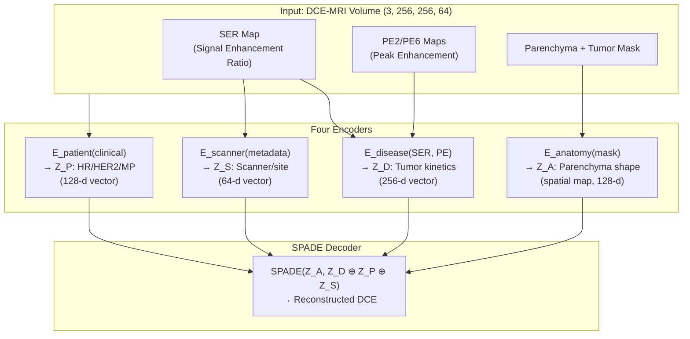

# Breast Cancer Implementation Plan — Horizon Disentangled

**Simplified, single-domain implementation** of all ideas from the EIC Pathfinder proposal,
adapted exclusively to breast cancer (I-SPY 2 + BreastDCEDL + DUKE cohorts).

> [!IMPORTANT]
> This plan replaces the multi-domain cluster implementation guide. All prostate/GBM-specific
> components (Gleason grading, PI-RADS, PSA doubling time, 177Lu-PSMA dosimetry) are removed
> and substituted with breast-cancer equivalents. The pipeline structure (5 stages) is unchanged.

---

## Table of Contents

1. [Design Rationale](#1-design-rationale)
2. [Data Strategy](#2-data-strategy)
3. [Stage 1 — Breast Supervisors](#3-stage-1--breast-supervisors)
4. [Stage 2 — Causal Disentangled VAE](#4-stage-2--causal-disentangled-vae)
5. [Stage 3 — OOD Detection](#5-stage-3--ood-detection)
6. [Stage 4 — NJDE Temporal Dynamics](#6-stage-4--njde-temporal-dynamics)
7. [Stage 5 — Counterfactual Synthesis & VLM Reporting](#7-stage-5--counterfactual-synthesis--vlm-reporting)
8. [Medical Knowledge Integration](#8-medical-knowledge-integration)
9. [Cluster Execution (H200)](#9-cluster-execution-h200)
10. [Validation Milestones](#10-validation-milestones)
11. [Work Package Mapping](#11-work-package-mapping)
12. [Alternative Approaches](#12-alternative-approaches)

---

## 1. Design Rationale

### Why Breast Cancer Only

The PDF proposal describes a **causal digital twin** for longitudinal oncology — the architecture is domain-agnostic, but the **validation** depends entirely on having interventional contrast. Breast cancer (I-SPY 2) provides:

| Requirement | Breast Cancer Data |
|:---|:---|
| Causal intervention diversity | **13 randomized treatment arms** (Paclitaxel ± 11 experimental agents + regimen switch to AC) |
| Counterfactual ground truth | Randomized trial → gold-standard ATE estimation |
| Longitudinal imaging | 4 structured timepoints (T0 → T1 → T2 → T3) with quantitative kinetic maps |
| Molecular subtypes for Z_P | HR, HER2, MammaPrint (complete, no missing) |
| Segmentation masks | 928 patients with DICOM-SEG |
| Total patients | ~1,375 (I-SPY 2 + DUKE + BreastDCEDL) |
| Pre-trained baseline | BreastDCEDL ViT (328 MB) for benchmarking |

### Domain Translation Map

Every prostate-specific concept from the PDF maps to a breast equivalent:

| PDF Concept (Prostate) | Breast Equivalent |
|:---|:---|
| Gleason Grade Groups (GGG 1–5) | **FTV Response Tiers** (progressive / stable / partial / near-pCR / pCR) |
| PI-RADS (1–5) | **BI-RADS + BPE Level** (minimal / mild / moderate / marked) |
| PSA Doubling Time (PSADT) | **FTV Decline Rate** = ln(2) × Δt / ln(FTV₀/FTV₁) |
| TNM stage | **Clinical Stage (I–IV)** + receptor subtype (HR+/HER2+/TN) |
| BCR (biochemical recurrence) | **pCR (pathological complete response)** — binary + RCB |
| Active Surveillance vs RP vs ADT | **13 I-SPY 2 treatment arms** (Pac ± drug) |
| 177Lu-PSMA dosimetry | **Enhancement kinetics PDE** (Fast-Slow Tofts model) |
| EAU Guidelines | **NCCN Breast NACT Guidelines** |
| Prostate zones (PZ/TZ) | **Breast parenchyma + BPE zones** |
| PSMA-PET uptake map | **SER (Signal Enhancement Ratio) kinetic map** |

---

## 2. Data Strategy

### 2.1 Available Datasets

| Dataset | Patients | Imaging | Clinical Features | Status |
|:---|:---:|:---|:---|:---:|
| **I-SPY 2** (ACRIN 6698) | 985 | 7,496 MR series (T1, T2, DCE, DWI, SER, PE) | pCR, FTV×4, Sphericity, LD, BPE, HR/HER2/MP, 13 arms | ✅ On XNAT |
| **DUKE BreastDCEDL** | 922 | DCE-MRI (3 kinetic phases) | Bilateral masks, parenchyma segmentation | ✅ On XNAT |
| **BreastDCEDL NIfTI** | 922 | Pre-processed NIfTI + MinCrop | ViT weights (328 MB benchmark) | ✅ On XNAT |

**Total**: ~1,375 unique patients, ~22 GB HDF5 on XNAT.

### 2.2 HDF5 Layout on XNAT

```
XNAT: temp / HORIZON_HDF5
├── breast_ispy2_s00..s07.h5   (13 GB)  — 985 I-SPY 2 patients
│   └── patients/{ISPY_ID}/visits/{T0,T1,T2,T3}/
│       ├── dce_volume    (3, 256, 256, 64) float32  — SER, PE2, PE6
│       ├── seg_mask      (1, 256, 256, 64) uint8    — tumor + parenchyma
│       ├── ftv            float32                    — Functional Tumor Volume
│       ├── sphericity     float32                    — Tumor sphericity
│       ├── longest_diam   float32                    — LD
│       ├── bpe_level      int8                       — Background Parenchymal Enhancement
│       └── clinical/
│           ├── hr_status    int8   — Hormone receptor (0/1)
│           ├── her2_status  int8   — HER2 (0/1)
│           ├── mammaprint   int8   — MammaPrint risk (0=low/1=high)
│           ├── treatment_arm str   — e.g. "Paclitaxel+Neratinib"
│           ├── pcr          int8   — pathological complete response (0/1)
│           └── rcb_class    int8   — Residual Cancer Burden (0–III)
├── breast_mincrop_s00..s02.h5 (7.1 GB) — 1,081 DUKE patients
│   └── patients/{DUKE_ID}/visits/v_0/
│       ├── breast_mincrop (3, 256, 256, 28–64)      — 3 kinetic phases
│       └── seg_mask       (1, 256, 256, 28–64)      — parenchyma
└── dataset_manifest.json                             — checksums
```

### 2.3 SLURM Data Staging

```bash
# Stage from XNAT to local NVMe before training
srun --ntasks-per-node=1 python scripts/data/xnat_download.py --download-dataset \
    --project temp --resource-label HORIZON_HDF5 \
    --output /tmp/horizon_hdf5
```

---

## 3. Stage 1 — Breast Supervisors

### PDF Points Implemented

| PDF Idea | Breast Adaptation |
|:---|:---|
| Segmentation Supervisor (3D U-Net / SwinUNETR) | **Tumor + parenchyma segmentation** from DCE-MRI |
| Ordinal Grading Supervisor (Gleason → ordinal) | **FTV Response Tier** ordinal classifier (5 classes) |
| Survival Supervisor (DeepSurv / Cox) | **pCR predictor** + residual cancer burden (RCB) risk |
| Differential Ordinal Loss (DIOR-ViT) | Same loss on FTV response tiers |
| Merlin InfoNCE contrastive | Same — align imaging features across timepoints |
| GradCAM + SHAP explainability | Same — applied to breast volumes |

### 3.1 Segmentation Supervisor

```python
class BreastSegmentationSupervisor(nn.Module):
    """
    3D segmentation: Background / Parenchyma / Tumor / BPE-High.
    Uses SwinUNETR backbone with VoComni-H weights.
    
    Input:  DCE volume (3, 256, 256, 64) — SER, PE2, PE6 channels
    Output: Mask (4, 256, 256, 64) — 4 tissue classes
    """
    def __init__(self):
        self.backbone = SwinUNETR(
            img_size=(256, 256, 64),
            in_channels=3,       # SER + PE2 + PE6
            out_channels=4,      # Background, Parenchyma, Tumor, BPE-High
            feature_size=48,
        )
        self.dice_loss = DiceCELoss(softmax=True)
    
    def forward(self, dce_volume, seg_mask):
        pred = self.backbone(dce_volume)
        loss = self.dice_loss(pred, seg_mask)
        return pred, loss
```

**Targets**: Dice > 0.85 for parenchyma, > 0.75 for tumor on 928-patient DUKE cohort.

### 3.2 FTV Response Ordinal Supervisor

The PDF's Gleason ordinal grading maps to **FTV response tiers**:

```python
# FTV response tiers (from I-SPY 2 continuous FTV measurements)
RESPONSE_TIERS = {
    0: "Progressive",    # FTV increased > 25%
    1: "Stable",         # FTV change < 25%
    2: "Partial",        # FTV decreased 25–50%
    3: "Near-pCR",       # FTV decreased > 50% but residual
    4: "pCR",            # FTV → 0, pathological complete response
}

class FTVOrdinalSupervisor(nn.Module):
    """
    Ordinal classifier for treatment response tiers.
    Uses CORAL ordinal loss (PDF: 'differential ordinal loss').
    
    Input:  Paired DCE volumes (T0 and T2) + clinical features
    Output: Response tier probabilities (5 ordered classes)
    """
    def __init__(self):
        self.encoder = SwinTransformer3D(in_channels=6)  # concat T0 + T2
        self.ordinal_head = CoralOrdinalHead(d_in=768, n_classes=5)
    
    def forward(self, volume_t0, volume_t2, clinical):
        paired = torch.cat([volume_t0, volume_t2], dim=1)  # (B, 6, D, H, W)
        feat = self.encoder(paired)
        return self.ordinal_head(feat)
```

**Loss**: Cumulative Link Model (CORAL) ordinal loss:
```
L_ordinal = Σ_{k=1}^{K-1} BCE(σ(θ_k - f(x)), 1[y > k])
```

### 3.3 pCR Survival Supervisor

The PDF's BCR DeepSurv maps to **pCR + RCB prediction**:

```python
class BreastSurvivalSupervisor(nn.Module):
    """
    Multimodal pCR predictor combining imaging + clinical features.
    
    Outputs:
        - pCR probability (binary classification)
        - RCB class probabilities (ordinal: 0, I, II, III)
        - FTV trajectory risk score (continuous)
    """
    def __init__(self):
        self.image_encoder = SwinUNETR_Encoder(in_channels=3)
        self.clinical_mlp = nn.Sequential(
            nn.Linear(16, 128), nn.GELU(),  # HR, HER2, MP, age, arm...
            nn.Linear(128, 256),
        )
        self.pcr_head = nn.Linear(1024, 1)        # sigmoid → pCR prob
        self.rcb_head = CoralOrdinalHead(1024, 4)  # ordinal → RCB 0/I/II/III
    
    def forward(self, volume, clinical_features):
        img_feat = self.image_encoder(volume)       # (B, 768)
        clin_feat = self.clinical_mlp(clinical_features)  # (B, 256)
        combined = torch.cat([img_feat, clin_feat], dim=-1)
        return {
            'pcr_prob': torch.sigmoid(self.pcr_head(combined)),
            'rcb_probs': self.rcb_head(combined),
        }
```

**Validation**: AUC > 0.75 for pCR prediction (benchmark against BreastDCEDL ViT).

### 3.4 SurvRNC with Distributed Negative Queue

```python
class BreastSurvRNC(nn.Module):
    """
    Survival Rank-N-Contrast adapted for breast cancer.
    H200: 2048 negatives across 4 GPUs via all_gather.
    
    Ranking criterion: patients with pCR rank higher (better outcome)
    than patients with RCB-III.
    """
    def __init__(self, d_feat=512, queue_size=2048):
        self.encoder = SwinUNETR_Encoder()
        self.surv_head = nn.Linear(d_feat, 1)
        self.register_buffer('queue', F.normalize(torch.randn(queue_size, d_feat)))
    
    def forward(self, volume, pcr, rcb):
        feat = self.encoder(volume)
        risk = self.surv_head(feat).squeeze(-1)
        all_feat = all_gather(feat)    # (N_global, D)
        all_pcr = all_gather(pcr)
        # Rank-N-Contrast: pcr=1 patients should have lower risk than pcr=0
        loss = rank_n_contrast_loss(risk, all_feat, all_pcr)
        return loss, risk
```

---

## 4. Stage 2 — Causal Disentangled VAE

### PDF Points Implemented

| PDF Idea | Breast Adaptation |
|:---|:---|
| SDNet encoder trio: E_anatomy, E_pathology, E_style | **E_parenchyma**(seg) → Z_A, **E_disease**(SER/PE) → Z_D, **E_patient**(HR/HER2/MP) → Z_P, **E_scanner**(site/vendor) → Z_S |
| SPADE normalization decoder | Same — parenchyma map Z_A guides spatial normalization |
| InfoNCE disentanglement | Same — Z_D ⊥ Z_S conditional on Z_A |
| β-TCVAE total correlation | Same — applied to breast latent space |
| Cross-modality synthesis | **SER ↔ PE ↔ T2 ↔ DWI** synthesis for missing sequences |

### 4.1 Breast Latent Space Design



### 4.2 Latent Subspace Definitions

| Latent | Dimension | Supervision Signal | What It Captures |
|:---|:---:|:---|:---|
| **Z_A** (anatomy) | 128 | Parenchyma segmentation mask | Breast shape, fibroglandular density, chest wall geometry |
| **Z_D** (disease) | 256 | SER map + FTV + tumor mask | Tumor enhancement kinetics, necrosis, washout patterns |
| **Z_P** (patient) | 128 | HR, HER2, MammaPrint, age, menopausal status | Molecular subtype, biological age, hormonal context |
| **Z_S** (scanner/style) | 64 | Site ID, collection (ispy2 / acrin_6698), field strength | Scanner artifacts, contrast agent protocol differences |

### 4.3 Disentanglement Losses

```python
L_total = (
    1.0  * L_recon          # MSE reconstruction of DCE volume
  + 0.001 * L_KL            # KL divergence for Z_D, Z_P, Z_S
  + 0.1  * L_GAN            # PatchGAN discriminator
  + 0.05 * L_InfoNCE        # Z_D ⊥ Z_S | Z_A (cross-patient negative pairs)
  + 0.5  * L_anatomy_CE     # Z_A → segmentation mask cross-entropy
  + 0.01 * L_TC             # β-TCVAE total correlation penalty
  + 0.1  * L_patient_cls    # Z_P → HR/HER2 classification
)
```

**Disentanglement targets** (PDF milestone M3):
- Mutual information MI(Z_D, Z_S) < 0.1
- 3D FID < 50 on 1000 generated vs 1000 real volumes
- Z_P correctly predicts HR/HER2/MammaPrint with AUC > 0.9

### 4.4 Cross-Modality Synthesis

The PDF proposes MRI↔CT synthesis for missing modalities. In breast cancer, we adapt this to synthesise missing DCE sequences:

```python
class BreastCrossModalSynthesizer(nn.Module):
    """
    Synthesise missing MR sequences from available ones.
    I-SPY 2 has variable modality availability:
        - SER/PE: 3163/7496 series (most common)
        - T2 FSE: 444/7496 series
        - DWI/ADC: 380/7496 series
    
    Train: paired sequences where available.
    Infer: generate missing T2/DWI from SER/PE.
    """
    def __init__(self):
        self.ser_enc = Encoder3D(in_channels=1, out_dim=256)
        self.pe_enc  = Encoder3D(in_channels=2, out_dim=256)
        self.t2_dec  = Decoder3D(in_channels=256, out_channels=1)
        self.dwi_dec = Decoder3D(in_channels=256, out_channels=1)
    
    def forward(self, ser=None, pe=None, target_modality='t2'):
        z = sum(enc(x) for enc, x in [(self.ser_enc, ser), (self.pe_enc, pe)] if x is not None)
        if target_modality == 't2':
            return self.t2_dec(z)
        return self.dwi_dec(z)
```

---

## 5. Stage 3 — OOD Detection

### PDF Points Implemented

| PDF Idea | Breast Adaptation |
|:---|:---|
| Lightweight AE on Z_D | Same — AE on breast Z_D (tumor kinetics latent) |
| KNN latent distance | Same — k-NN in Z_D space |
| Label-noise detection | **Discordant FTV-vs-pCR** flag (FTV↓ but pCR=0, or FTV↑ but pCR=1) |
| Pseudo-progression flagging | **SER miscalibration detection** (SER stored as ×1000 integers) |

### 5.1 Breast-Specific OOD Cases

```python
class BreastOODDetector(nn.Module):
    """
    Flag unusual breast cancer presentations:
    
    1. SER miscalibration: SER values stored as ×1000 integers 
       in some series → extreme outlier in Z_D
    2. Bilateral outliers: 635 bilateral series with potential 
       contralateral artifacts
    3. FTV-pCR discordance: patients where FTV trajectory and 
       pathological outcome are inconsistent
    4. Cross-site domain shift: systematic Z_S drift between 
       I-SPY 2 sites
    """
    def __init__(self, d_latent=256, n_ensemble=8):
        self.aes = nn.ModuleList([
            nn.Sequential(
                nn.Linear(d_latent, 64), nn.ReLU(),
                nn.Linear(64, 16), nn.ReLU(),
                nn.Linear(16, 64), nn.ReLU(),
                nn.Linear(64, d_latent),
            ) for _ in range(n_ensemble)
        ])
        self.flow = NormalizingFlow(d_latent, n_layers=8)
    
    def ood_score(self, z_d):
        recons = torch.stack([ae(z_d) for ae in self.aes])
        recon_var = recons.var(dim=0).mean(dim=-1)
        log_px = self.flow.log_prob(z_d)
        return {
            'ood_score': recon_var - log_px,
            'is_ood': (recon_var - log_px) > self.threshold,
        }
```

---

## 6. Stage 4 — NJDE Temporal Dynamics

### This is where breast cancer uniquely excels.

### PDF Points Implemented

| PDF Idea | Breast Adaptation |
|:---|:---|
| Continuous drift: dz/dt = f(z, t, c) | **Tumor shrinkage dynamics** under neoadjuvant chemotherapy |
| Discrete jumps: z(t⁺) = z(t⁻) + g(z, intervention) | **13 treatment-arm jumps** at T0 + regimen switch at T2 |
| Guideline pre-training | **NCCN NACT breast guidelines** → synthetic trajectory generation |
| 1024 parallel trajectories | Same — per GPU, using `torch.func.vmap` |
| Leave-one-timepoint-out validation | T0 → T1 → T2 prediction, validate against T3 |
| Masked loss for irregular time | I-SPY 2 has structured T0/T1/T2/T3 — simpler but reliable |

### 6.1 State Vector Definition

```python
# Breast cancer patient state at time t
# dim = 6 continuous features + 128-d Z_D latent = 134-d total

class BreastPatientState:
    """
    State vector v(t) for NJDE:
    
    Quantitative features (from I-SPY 2 at each timepoint):
        - FTV:         Functional Tumor Volume (cm³)
        - Sphericity:  Tumor shape regularity (0–1)
        - LD:          Longest diameter (mm)
        - BPE:         Background Parenchymal Enhancement level (0–3)
        - SER_mean:    Mean Signal Enhancement Ratio in tumor
        - PE_max:      Max Peak Enhancement in tumor
    
    Latent features (from Stage 2 VAE):
        - Z_D:         Disease latent vector (128-d)
    """
    quantitative_features = ['ftv', 'sphericity', 'ld', 'bpe', 'ser_mean', 'pe_max']
    d_quantitative = 6
    d_latent = 128
    d_total = 134
```

### 6.2 NJDE Architecture

```python
class BreastNJDE(nn.Module):
    """
    Neural Jump ODE for breast cancer trajectory prediction.
    
    Continuous drift: tumor evolution between clinical events
    Discrete jumps:   treatment initiation (13 arms) + regimen switch
    
    Timeline:
        T0 (baseline) → [JUMP: drug start] → T1 (3 wk) → T2 (12 wk) 
        → [JUMP: switch to AC] → T3 (24 wk, pre-surgery)
    """
    def __init__(self, d_state=134, d_hidden=512, d_treatment=64):
        super().__init__()
        # Continuous drift network
        self.drift = nn.Sequential(
            nn.Linear(d_state + d_treatment, d_hidden), nn.SiLU(),
            nn.Linear(d_hidden, d_hidden), nn.SiLU(),
            nn.Linear(d_hidden, d_state),
        )
        # Treatment arm embedding (13 arms + control)
        self.treatment_emb = nn.Embedding(14, d_treatment)
        
        # Jump network: discrete state update at treatment events
        self.jump_gate = nn.Sequential(
            nn.Linear(d_state + d_treatment, d_hidden), nn.SiLU(),
            nn.Linear(d_hidden, d_state), nn.Sigmoid(),
        )
        self.jump_delta = nn.Sequential(
            nn.Linear(d_state + d_treatment, d_hidden), nn.SiLU(),
            nn.Linear(d_hidden, d_state),
        )
    
    def f(self, t, z, treatment_context):
        """Continuous drift: dz/dt = f(z, t, c)"""
        c = self.treatment_emb(treatment_context)
        return self.drift(torch.cat([z, c], dim=-1))
    
    def jump(self, z_before, treatment_arm):
        """Discrete jump at treatment start: z⁺ = z⁻ + gate ⊙ Δ"""
        c = self.treatment_emb(treatment_arm)
        zc = torch.cat([z_before, c], dim=-1)
        gate = self.jump_gate(zc)
        delta = self.jump_delta(zc)
        return z_before + gate * delta
    
    def forward(self, z0, treatment_arm, t_span):
        """
        Full trajectory: T0 → T3
        
        z0:             Initial state at T0 (B, 134)
        treatment_arm:  Arm index 0–13 (B,)
        t_span:         [0, 3, 12, 24] weeks
        """
        # Jump at T0: apply treatment initiation
        z_post_drug = self.jump(z0, treatment_arm)
        
        # Continuous drift T0 → T2 (12 weeks)
        c = treatment_arm
        traj_1 = odeint(lambda t, z: self.f(t, z, c), z_post_drug, 
                        t_span[:3], method='rk4')
        
        # Jump at T2: regimen switch (all arms switch to AC)
        z_at_t2 = traj_1[-1]
        AC_ARM = 13  # AC chemotherapy code
        z_post_switch = self.jump(z_at_t2, torch.full_like(c, AC_ARM))
        
        # Continuous drift T2 → T3 (24 weeks)
        traj_2 = odeint(lambda t, z: self.f(t, z, torch.full_like(c, AC_ARM)),
                        z_post_switch, t_span[2:], method='rk4')
        
        return torch.cat([traj_1, traj_2[1:]], dim=0)  # (T, B, D)
```

### 6.3 Treatment Arms & Jump Types

The PDF envisions 2 jump types (surgery + RT) for prostate. With breast cancer we get **15+ distinct jumps**:

| Jump Event | Trigger Time | Arms | Effect on State |
|:---|:---:|:---:|:---|
| Drug initiation (T0) | Week 0 | 13 | Each arm: different Z_D trajectory modification |
| Regimen switch to AC | Week 12 | 1 (all) | Uniform jump: different mechanism of action |
| Drug escalation | Variable | Some arms | Dose-dependent Z_D shift |

```python
# I-SPY 2 treatment arm encoding
TREATMENT_ARMS = {
    0:  "Paclitaxel_control",
    1:  "Paclitaxel+AMG386",        # anti-angiogenic
    2:  "Paclitaxel+Neratinib",     # pan-HER TKI
    3:  "Paclitaxel+Ganitumab",     # anti-IGF1R
    4:  "Paclitaxel+Ganetespib",    # HSP90 inhibitor
    5:  "Paclitaxel+MK2206",        # AKT inhibitor
    6:  "Paclitaxel+TDM1",          # antibody-drug conjugate
    7:  "Paclitaxel+Pembrolizumab", # anti-PD1
    8:  "Paclitaxel+Trastuzumab",   # anti-HER2
    9:  "Paclitaxel+Carboplatin",   # platinum agent
    10: "Paclitaxel+Pertuzumab",    # anti-HER2 dimerisation
    11: "Paclitaxel+ABT888",        # PARP inhibitor
    12: "Paclitaxel+Other",         # remaining arms
    13: "AC_switch",                 # Adriamycin + Cyclophosphamide
}
```

### 6.4 NCCN Guideline Pre-training

The PDF proposes EAU guideline pre-training for prostate. For breast, we use **NCCN NACT guidelines**:

```python
def nccn_breast_reward(state: dict, treatment: str) -> float:
    """
    NCCN Breast Cancer NACT guideline reward function.
    Returns 1.0 if treatment matches guidelines, 0.0 otherwise.
    """
    hr, her2, mp = state['hr'], state['her2'], state['mammaprint']
    
    # Triple-negative: recommend Pembrolizumab + Carboplatin + Paclitaxel
    if not hr and not her2:
        return 1.0 if 'Pembrolizumab' in treatment or 'Carboplatin' in treatment else 0.3
    
    # HER2+: recommend Trastuzumab + Pertuzumab
    if her2:
        return 1.0 if 'Trastuzumab' in treatment or 'Pertuzumab' in treatment else 0.2
    
    # HR+/HER2-: recommend chemotherapy if MammaPrint high risk
    if hr and not her2:
        if mp == 1:  # high risk
            return 0.8  # NACT reasonable
        return 0.3      # consider omitting NACT for low risk
    
    return 0.5

# Pre-train NJDE on 10,000 synthetic NCCN-compliant trajectories
for epoch in range(500):
    synthetic = generate_nccn_synthetic_cohort(n=10000)
    actions = njde_policy(synthetic)
    rewards = torch.stack([nccn_breast_reward(p, a) for p, a in zip(synthetic, actions)])
    loss = -rewards.mean()
    loss.backward(); optimizer.step()
```

### 6.5 FTV Decline Rate (replaces PSADT)

```python
def ftv_decline_rate(ftv_t0: float, ftv_t2: float, delta_weeks: float = 12.0) -> float:
    """
    FTV Decline Rate = ln(2) × Δt / ln(FTV₀ / FTV₁)
    
    Analogous to PSA Doubling Time (PSADT) from the PDF.
    Positive = tumor shrinking, Negative = tumor growing.
    """
    if ftv_t0 <= 0 or ftv_t2 <= 0 or ftv_t0 == ftv_t2:
        return float('inf')
    return math.log(2) * delta_weeks / math.log(ftv_t0 / ftv_t2)
```

### 6.6 Enhancement Kinetics PDE (replaces 177Lu-PSMA Dosimetry)

The PDF's Fisher-KPP PDE for 177Lu-PSMA dosimetry maps to a **pharmacokinetic enhancement model**:

```python
class BreastEnhancementPDE(nn.Module):
    """
    Fast-Slow Tofts pharmacokinetic model for DCE-MRI.
    Replaces the prostate 177Lu-PSMA dosimetry PDE from the proposal.
    
    Models contrast agent dynamics in breast tissue:
        dC/dt = K_trans × (C_p - C/v_e) - SpectralLaplacian(C)
    
    where:
        C:       tissue contrast concentration (3D volume)
        C_p:     arterial input function (AIF)
        K_trans: transfer constant (vascular permeability)
        v_e:     extravascular extracellular volume fraction
    """
    def __init__(self, grid_shape=(64, 64, 16)):
        super().__init__()
        self.K_trans = nn.Parameter(torch.tensor(0.1))   # vascular permeability
        self.v_e = nn.Parameter(torch.tensor(0.3))       # EES volume fraction
        self.D = nn.Parameter(torch.tensor(0.01))        # diffusion coefficient
    
    def forward(self, C0, C_p_curve, dt=0.5, n_steps=100):
        """Simulate contrast enhancement dynamics."""
        C = C0.clone()
        for i in range(n_steps):
            C_p = C_p_curve[min(i, len(C_p_curve)-1)]
            laplacian_C = SpectralLaplacian3D.apply(C)
            dC = self.K_trans * (C_p - C / self.v_e) + self.D * laplacian_C
            C = C + dt * dC
        return C  # Predicted enhancement map
```

**Purpose**: Learn spatially-resolved pharmacokinetic parameters → predict treatment response from early enhancement patterns.

---

## 7. Stage 5 — Counterfactual Synthesis & VLM Reporting

### This is the killer application — uniquely enabled by I-SPY 2's randomized design.

### PDF Points Implemented

| PDF Idea | Breast Adaptation |
|:---|:---|
| do-calculus interventions | **do(arm=X)** → switch treatment arm in NJDE context |
| 1024 parallel counterfactual trajectories | Same — vmap over trajectories per GPU |
| In-silico clinical trials | **Simulate all 13 arms for each patient** → compare with actual trial outcomes |
| ATE estimation | **Gold-standard validation** against randomized arm assignments |
| VLM clinical report | Hulu-Med-32B report adapted for breast cancer |

### 7.1 In-Silico Trial Simulation

```python
def run_breast_insitu_trial(
    patient_cohort: list,         # 985 I-SPY 2 patients
    followup_weeks: int = 24,
) -> dict:
    """
    Simulate all 13 treatment arms for each patient.
    Compare predicted pCR rate against actual observed pCR rate.
    
    This is the core validation of the causal AI framework.
    """
    results = {}
    for arm_idx, arm_name in TREATMENT_ARMS.items():
        if arm_idx == 13:
            continue  # AC switch is not an initial arm
        
        # Counterfactual: "What if this patient received arm X?"
        z0_all = encode_patients(patient_cohort)              # (N, 134)
        trajectories = njde.forward(z0_all, arm_idx, [0, 3, 12, 24])
        
        # Decode final state to pCR prediction
        z_final = trajectories[-1]                            # (N, 134)
        pcr_pred = pcr_decoder(z_final)                       # (N,)
        
        results[arm_name] = {
            'predicted_pcr_rate': pcr_pred.mean().item(),
            'predicted_pcr_by_subtype': {
                'HR+/HER2-': pcr_pred[hr_mask & ~her2_mask].mean(),
                'HER2+':     pcr_pred[her2_mask].mean(),
                'TN':        pcr_pred[~hr_mask & ~her2_mask].mean(),
            },
        }
    
    # Validate against actual trial outcomes
    for arm_name, actual_pcr_rate in actual_trial_pcr_rates.items():
        predicted = results[arm_name]['predicted_pcr_rate']
        print(f"{arm_name}: predicted={predicted:.1%} vs actual={actual_pcr_rate:.1%}")
    
    return results
```

### 7.2 Counterfactual Validation

```python
def validate_counterfactuals(njde, patients, actual_assignments):
    """
    Gold-standard counterfactual validation using randomized trial design.
    
    For each patient who actually received arm A:
    1. Predict outcome under arm A → compare with actual outcome
    2. Predict outcome under arm B (counterfactual) 
    3. Compute ATE = E[Y(A) - Y(B)] and compare with trial's observed ATE
    """
    # Factual accuracy: predict actual arm outcomes
    factual_preds = []
    for patient, actual_arm in zip(patients, actual_assignments):
        z0 = encode_patient(patient)
        traj = njde(z0, actual_arm, [0, 3, 12, 24])
        pred_pcr = pcr_decoder(traj[-1])
        factual_preds.append(pred_pcr)
    
    factual_auc = roc_auc_score(actual_pcr_labels, factual_preds)
    
    # ATE validation: compare model's treatment effect with trial's
    for arm_a, arm_b in itertools.combinations(range(13), 2):
        # Model's predicted ATE
        pred_a = predict_pcr_rate(njde, patients, arm_a)
        pred_b = predict_pcr_rate(njde, patients, arm_b)
        model_ate = pred_a - pred_b
        
        # Trial's observed ATE (from actual randomized outcomes)
        obs_a = actual_pcr_rates[arm_a]
        obs_b = actual_pcr_rates[arm_b]
        trial_ate = obs_a - obs_b
        
        print(f"ATE({arm_a} vs {arm_b}): model={model_ate:.3f} trial={trial_ate:.3f}")
    
    return factual_auc
```

### 7.3 VLM Clinical Report (Breast-Adapted)

```python
def generate_breast_report(patient_state: dict) -> str:
    """
    Hulu-Med-32B clinical report for breast cancer trajectory.
    Replaces the prostate-specific report template from the PDF.
    """
    prompt = f"""
    Patient: {patient_state['age']}yo {patient_state['menopausal_status']}
    Receptor status: HR={patient_state['hr']}, HER2={patient_state['her2']}, 
                     MammaPrint={patient_state['mammaprint']}
    
    Current NACT regimen: {patient_state['treatment_arm']}
    
    Trajectory prediction (T0 → T3):
    - FTV: {patient_state['ftv_trajectory']} cm³
    - FTV decline rate: {patient_state['ftv_decline_rate']:.1f} weeks
    - Predicted pCR probability: {patient_state['pcr_prob']:.1%}
      (95% CI: {patient_state['pcr_ci']})
    - Predicted RCB class: {patient_state['rcb_pred']}
    
    Counterfactual analysis:
    - Best alternative arm: {patient_state['best_alt_arm']}
      (would increase pCR probability by {patient_state['pcr_uplift']:.1%})
    
    Generate a structured clinical report covering:
    1. Summary of findings and current treatment response
    2. FTV trajectory interpretation 
    3. Counterfactual treatment analysis
    4. Recommendation for treatment continuation vs early switch
    5. Uncertainty quantification and limitations
    
    Report:"""
    return hulu_med_32b.generate(prompt, max_new_tokens=1024, temperature=0.3)
```

---

## 8. Medical Knowledge Integration

### 8.1 Feature-Level (replaces PSA/Gleason)

| PDF Feature | Breast Equivalent | Computation |
|:---|:---|:---|
| PSA level | **FTV** (Functional Tumor Volume) | From DCE segmentation |
| PSA Doubling Time | **FTV Decline Rate** | ln(2) × Δt / ln(FTV₀/FTV₁) |
| Gleason score | **Receptor subtype** | HR/HER2/MammaPrint combination |
| Tumor volume (cc) | **Tumor volume** from segmentation | Voxel count × voxel volume |
| PI-RADS score | **BPE level** (0–3) | Background Parenchymal Enhancement |

### 8.2 Radiomics Features

```python
# PyRadiomics extraction from breast DCE volumes
extractor = featureextractor.RadiomicsFeatureExtractor()
extractor.enableFeatureClassByName('shape')       # sphericity, elongation, flatness
extractor.enableFeatureClassByName('firstorder')   # mean, skewness of enhancement
extractor.enableFeatureClassByName('glcm')         # texture heterogeneity

# Extract per-timepoint features → trajectory input for NJDE
for timepoint in ['T0', 'T1', 'T2', 'T3']:
    features = extractor.execute(dce_image[timepoint], tumor_mask[timepoint])
    # → 141 features per timepoint
```

### 8.3 LLM-Extracted Features

```python
def extract_breast_clinical(ehr_text: str) -> dict:
    """Use Hulu-Med-32B to extract structured features from pathology reports."""
    prompt = f"""Extract from this breast cancer pathology report as JSON:
- receptor_status: {{hr: bool, her2: bool, ki67_percent: float}}
- tumor_size_cm: float
- lymph_node_status: "pN0" / "pN1" / ...
- grade: "1" / "2" / "3"
- margins: "clear" / "involved"
- pcr: bool (if mentioned)
- rcb_index: float (if mentioned)

Report: {ehr_text}
JSON:"""
    return json.loads(hulu_med.generate(prompt))
```

---

## 9. Cluster Execution (H200)

### 9.1 Resource Allocation

| Stage | GPUs | VRAM/GPU | Batch | Time Est. |
|:---|:---:|:---:|:---:|:---:|
| **Stage 1** (Supervisors) | 4× H200 | 141 GB | 8 vols/GPU | ~4h |
| **Stage 2** (Causal VAE) | 4× H200 | 141 GB | 8 vols/GPU | ~8h |
| **Stage 3** (OOD) | 1× H200 | 141 GB | Full cohort | ~30min |
| **Stage 4** (NJDE) | 4× H200 | 141 GB | 256 trajs/GPU | ~6h |
| **Stage 5** (VLM) | 4× H200 | 141 GB | 1 report/GPU | ~2h |
| **Total** | | | | **~20h** |

### 9.2 SLURM Pipeline

```bash
#!/bin/bash
# scripts/training/slurm_pipeline_cluster.sbatch breast 100
# Simplified: breast cancer only

DOMAIN="breast"
EPOCHS="${1:-100}"
PARTITION="${2:-gpu}"

cd /DATA/horizon_disentangled

# Stage data from XNAT
srun --ntasks-per-node=1 python scripts/data/xnat_download.py \
    --download-dataset --project temp --resource-label HORIZON_HDF5 \
    --output /tmp/horizon_hdf5

# Sequential stage training with SLURM dependency chain
JOB1=$(sbatch --parsable --gres=gpu:h200:4 --mem=512G --time=8:00:00 \
    --wrap="torchrun --nproc_per_node=4 scripts/training/train_full.py \
            --stage 1 --domain breast --epochs $EPOCHS")

JOB2=$(sbatch --parsable --dependency=afterok:$JOB1 --gres=gpu:h200:4 \
    --wrap="torchrun --nproc_per_node=4 scripts/training/train_full.py \
            --stage 2 --domain breast --epochs $EPOCHS")

JOB3=$(sbatch --parsable --dependency=afterok:$JOB2 --gres=gpu:1 \
    --wrap="python scripts/training/train_full.py \
            --stage 3 --domain breast")

JOB4=$(sbatch --parsable --dependency=afterok:$JOB3 --gres=gpu:h200:4 \
    --wrap="torchrun --nproc_per_node=4 scripts/training/train_full.py \
            --stage 4 --domain breast --epochs $((EPOCHS/2))")

JOB5=$(sbatch --parsable --dependency=afterok:$JOB4 --gres=gpu:h200:4 \
    --wrap="torchrun --nproc_per_node=4 scripts/training/train_full.py \
            --stage 5 --domain breast")

echo "Pipeline: $JOB1 → $JOB2 → $JOB3 → $JOB4 → $JOB5"
```

### 9.3 Key Cluster Config

```python
# src/config.py — breast cancer cluster configuration
BREAST_CLUSTER_CONFIG = {
    'hardware': {
        'gpus_per_node': 4,
        'gpu_type': 'H200',
        'vram_per_gpu_gb': 141,
        'precision': 'bf16',          # BF16 primary, FP8 for attention
        'compile_mode': 'max-autotune',
    },
    'data': {
        'domain': 'breast',
        'input_shape': (3, 256, 256, 64),   # SER + PE2 + PE6
        'n_patients': 1375,
        'n_timepoints': 4,                   # T0, T1, T2, T3
        'n_treatment_arms': 13,
    },
    'training': {
        'batch_size_per_gpu': 8,
        'gradient_checkpointing': True,
        'fsdp_sharding': 'FULL_SHARD',
    },
    'njde': {
        'd_state': 134,
        'n_parallel_trajectories': 1024,
        'solver': 'rk4',
        'use_spectral_laplacian': True,
    },
}
```

---

## 10. Validation Milestones

All milestones from the PDF, adapted to breast cancer:

| Milestone | PDF Target | Breast Implementation | Metric |
|:---|:---|:---|:---|
| **M1** | Data pipeline ≥500 patients | HDF5 on XNAT: 1,375 breast patients | ✅ Already exceeds |
| **M2** | Supervisor AUC > 0.75 | pCR prediction AUC on I-SPY 2 | Benchmark vs BreastDCEDL ViT |
| **M3** | Latent MI < 0.1, 3D FID | MI(Z_D, Z_S) < 0.1 on breast VAE | 3D FID on 1000 generated breast volumes |
| **M4** | Trajectory R² > 0.6, C-index > 0.7 | FTV trajectory R² at T3 prediction | C-index for pCR from NJDE final state |
| **M5** | Counterfactual plausibility > 80% | Model ATE vs trial ATE correlation > 0.8 | Clinician plausibility review of 100 counterfactuals |
| **M6** | PDE credible dosimetry | Enhancement kinetics PDE matches observed SER maps | Tofts K_trans error < 20% vs ground truth |

---

## 11. Work Package Mapping

| Work Package | PDF Scope | Breast-Only Implementation |
|:---|:---|:---|
| **WP1** Data (18 PM) | Multi-centre collection | I-SPY 2 + DUKE from XNAT; combat harmonisation across sites |
| **WP2** Supervisors (12 PM) | Seg + ordinal + survival | Breast seg (928 pts), FTV ordinal (384 pts), pCR predictor |
| **WP3** VAE (12 PM) | Disentangle Z_A/Z_D/Z_P/Z_S | 4 breast-specific latent subspaces; InfoNCE + β-TCVAE |
| **WP4** NJDE (12 PM) | Temporal dynamics + jumps | 13-arm jump network; NCCN pre-training; FTV trajectory |
| **WP5** Validation (18 PM) | Counterfactual + in-silico trial | Gold-standard I-SPY 2 randomized trial validation |
| **WP6** GenAI (12 PM) | Synthetic data augmentation | MAISI breast synthesis; cross-modal SER↔T2↔DWI |
| **WP7** Explainability (12 PM) | Attention maps + SHAP | GradCAM-3D on breast DCE; SHAP for HR/HER2 contributions |
| **WP8** Dissemination (36 PM) | W&B dashboards, papers | Same infrastructure |
| **WP9** AI Act (18 PM) | MDR Class IIb compliance | Same infrastructure; audit trails for breast predictions |

---

## 12. Alternative Approaches

> Every "what else could be tried" from the PDF, adapted to breast cancer.

| Component | Current Approach | Alternative 1 | Alternative 2 | Alternative 3 |
|:---|:---|:---|:---|:---|
| **Segmentation** | SwinUNETR on DCE | SAM2-3D breast masks | nnU-Net breast | VISTA3D with breast anatomy |
| **pCR prediction** | SurvRNC + pCR head | BreastDCEDL ViT (baseline) | Multi-task pCR + RCB | Radiomics + XGBoost |
| **Ordinal response** | CORAL loss on FTV tiers | Earth Mover Distance loss | Unimodal distribution constraint | Label-smoothed ordinal |
| **VAE disentangle** | InfoNCE + GAN + TC | β-TCVAE only | Factor VAE | CausalVAE (DAG latent) |
| **Cross-modal** | Encoder per modality | SynDiff (SER→T2) | CycleGAN-3D | MAR autoregressive |
| **NJDE drift** | MLP + odeint | Mamba SSM | Graph NDE | Latent SDE |
| **NJDE jumps** | Gated MLP per arm | Attention over drug properties | Drug fingerprint embeddings | GNN drug interaction |
| **Pre-training** | NCCN synthetic rules | Constitutional AI | Knowledge graph | Inverse RL from real trials |
| **Trajectories** | 1024-ensemble + vmap | Conformal prediction | Probabilistic SDE | Gaussian Process |
| **Counterfactuals** | do-calculus NJDE | Causal diffusion models | Structural Causal Models | Double ML |
| **Enhancement PDE** | Fast-Slow Tofts | Population PK/PD model | Physics-informed neural network | Bayesian PK parameter estimation |
| **VLM reporting** | Hulu-Med-32B 4-bit | BiomedCLIP + LLaMA-3 | LLaVA-Med-3D | RAG + NCCN guidelines |
| **Explainability** | GradCAM-3D + SHAP | Concept Bottleneck Models | Integrated Gradients | TCAV (SER concept) |
| **OOD detection** | Ensemble AE + flow | Energy-based models | Mahalanobis distance | Deep kernel learning |
| **Compliance** | MLflow audit + DP | Conformal prediction (guaranteed coverage) | Homomorphic encryption | Rényi DP accounting |

---

*Document: Breast Cancer Implementation Plan v1.0*  
*Date: 2026-11-22*  
*Domain: Breast Cancer only (I-SPY 2 + DUKE + BreastDCEDL)*  
*Cluster: 4× H200 SXM (564 GB VRAM)*  
*XNAT: 22 GB HDF5 across 16 files in HORIZON_HDF5*
