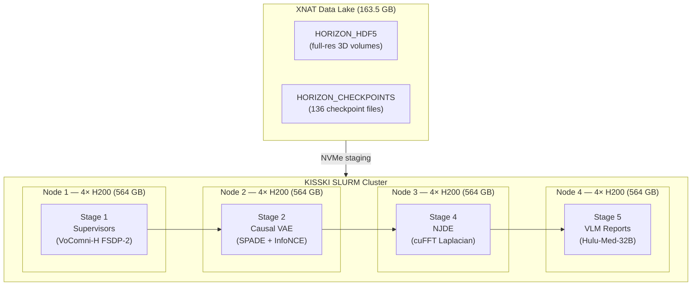
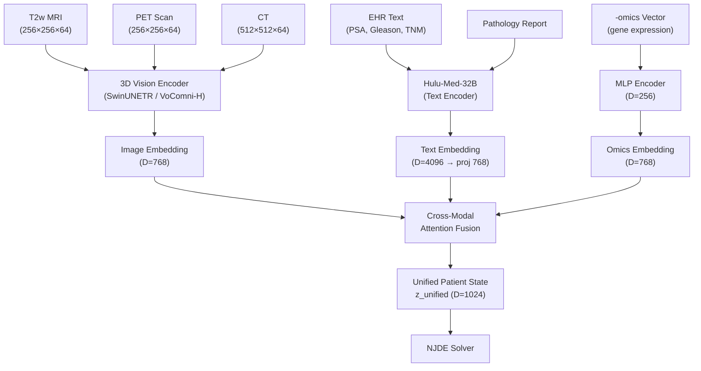

# Cluster Implementation Guide — EIC Pathfinder Proposal → 4× H200 Reality

**Document**: Detailed mapping of every technical point from the EU EIC Pathfinder grant proposal  
*"A Causal AI Framework for Longitudinal Modelling of Prostate Cancer"* (Nov 18 2026)  
to concrete implementation on the **KISSKI 4-node × 4× H200 SXM cluster**.

**Related docs**:
- [`h200_cluster_scaling_guide.md`](file:///DATA/horizon_disentangled/docs/h200_cluster_scaling_guide.md) — hardware, FSDP-2, SLURM, FP8 details  
- [`xnat_checkpoints_guide.md`](file:///DATA/horizon_disentangled/docs/xnat_checkpoints_guide.md) — 136 files / 163.5 GB on XNAT  
- [`xnat_dataset_guide.md`](file:///DATA/horizon_disentangled/docs/xnat_dataset_guide.md) — HDF5 dataset access  
- [`ARCHITECTURE.md`](file:///DATA/horizon_disentangled/docs/ARCHITECTURE.md) — 4-stage pipeline overview  

---

## Table of Contents

1. [Philosophy & Cluster Topology](#1-philosophy--cluster-topology)
2. [Technology Area 1 — GenAI Dataset Synthesis](#2-technology-area-1--genai-dataset-synthesis)
   - 2.1 [Counterfactual Image Synthesis](#21-counterfactual-image-synthesis)
   - 2.2 [Cross-Modality Synthesis (MRI ↔ CT)](#22-cross-modality-synthesis-mri--ct)
3. [NJDE Multimodal Integration Framework](#3-njde-multimodal-integration-framework)
   - 3.1 [Multimodal Data Fusion (MRI + EHR + Pathology + -omics)](#31-multimodal-data-fusion)
   - 3.2 [NJDE Architecture & Cluster Training](#32-njde-architecture--cluster-training)
4. [Medical Knowledge Integration](#4-medical-knowledge-integration)
   - 4.1 [Feature-Level: PSA Doubling Time, Tumor Volume](#41-feature-level-psa-doubling-time-tumor-volume)
   - 4.2 [Architectural: VAE Latent Disentanglement (s / z_p / z_s)](#42-architectural-vae-latent-disentanglement)
   - 4.3 [Loss-Level: Differential Ordinal Loss (Gleason / PI-RADS)](#43-loss-level-differential-ordinal-loss)
   - 4.4 [Training Strategy: EAU Guideline Pre-training](#44-training-strategy-eau-guideline-pre-training)
5. [Clinical Area — Predictive Diagnosis & In-Silico Trials](#5-clinical-area--predictive-diagnosis--in-silico-trials)
   - 5.1 [TNM / PI-RADS / BCR Trajectory Prediction](#51-tnm--pi-rads--bcr-trajectory-prediction)
   - 5.2 [In-Silico Clinical Trials & Counterfactuals](#52-in-silico-clinical-trials--counterfactuals)
   - 5.3 [177Lu-PSMA Therapy Optimisation](#53-177lu-psma-therapy-optimisation)
6. [Stage 1 — Supervisors](#6-stage-1--supervisors)
   - 6.1 [Segmentation Supervisor](#61-segmentation-supervisor)
   - 6.2 [Ordinal Grading Supervisor (Gleason / PI-RADS)](#62-ordinal-grading-supervisor)
   - 6.3 [Survival Supervisor (DeepSurv / Cox)](#63-survival-supervisor)
7. [Stage 2 — Causal Disentangled VAE](#7-stage-2--causal-disentangled-vae)
8. [Stage 3 — OOD Detector](#8-stage-3--ood-detector)
9. [Stage 4 — Neural Jump ODE (NJDE) Dynamics](#9-stage-4--neural-jump-ode-dynamics)
10. [Stage 5 — Synthesis & Reporting (VLM Layer)](#10-stage-5--synthesis--reporting-vlm-layer)
11. [Data Strategy: LUMIERE / DUKE / EUCAIM / KISSKI](#11-data-strategy-lumiere--duke--eucaim--kisski)
12. [Validation Milestones (M1–M6) on Cluster](#12-validation-milestones-m1m6-on-cluster)
13. [Work Package ↔ Cluster Execution Mapping (WP1–WP9)](#13-work-package--cluster-execution-mapping)
14. [Infrastructure & Cluster Configuration](#14-infrastructure--cluster-configuration)
15. [Explainability & Uncertainty (WP7)](#15-explainability--uncertainty-wp7)
16. [AI Act / MDR Compliance (WP9)](#16-ai-act--mdr-compliance-wp9)
17. [Alternative Approaches Summary Table](#17-alternative-approaches-summary-table)

---

## 1. Philosophy & Cluster Topology

### Core Principle

The proposal describes a **causal digital twin** architecture: fusing imaging (MRI/CT/PET), EHR, pathology, and -omics into a unified patient state vector that can be evolved forward in time and queried counterfactually. The 4×H200 cluster unlocks three things that are impossible on a single H100:

1. **Full-resolution 3D volumes** without patch-based approximation (141 GB VRAM per GPU)
2. **1024+ parallel counterfactual trajectories** per batch for in-silico trials
3. **Unfrozen foundation model backbones** (VoComni-H 1.16B, Hulu-Med-32B 32B-param) via FSDP-2 sharding



### Cluster Configuration Quick Reference

| Parameter | Value |
|:---|:---|
| Nodes | 4 × (4× H200 SXM) |
| Total VRAM | 16 × 141 GB = **2.256 TB** |
| Interconnect | NDR 400 Gbps InfiniBand + NVLink 4 |
| NVMe burst buffer | 7.5 GB/s read per node |
| SLURM script | [`scripts/submit_cluster.sh`](file:///DATA/horizon_disentangled/scripts/submit_cluster.sh) |
| Environment | `h200` conda env ([`environment_h200.yml`](file:///DATA/horizon_disentangled/environment_h200.yml)) |
| Precision | FP8 (Transformer Engine) + BF16 fallback |
| Parallelism | FSDP-2 (model) + DDP (data) |

---

## 2. Technology Area 1 — GenAI Dataset Synthesis

### 2.1 Counterfactual Image Synthesis

#### Proposal Point
> *"Synthesise the patient scan at a different age or disease stage — advanced counterfactual image synthesis using diffusion models."*

#### Current Local Implementation (H100 single GPU)
- [`src/pipeline/stage2_causal_vae/`](file:///DATA/horizon_disentangled/src/pipeline/stage2_causal_vae/) — Stage 2 VAE latent walk
- **MedVAE** 8× spatial compression: input 96³ patch → 12³ latent grid (24×28×20 for prostate volumes)
- Counterfactual: modify `z_p` (pathology latent), decode → synthesised image at new disease state
- **Limitation**: 96³ patch-based, loses global anatomy context; coarse latent grid

#### Cluster H200 Implementation

**Step 1 — Full-volume MAISI CT generation**
```python
# XNAT checkpoint: HORIZON_CHECKPOINTS/maisi/maisi_ct_generative_v0.3.pt (5.2 GB)
from monai.apps.generation.maisi.networks.autoencoderKL_maisi import AutoencoderKlMaisi
from monai.apps.generation.maisi.networks.diffusion_model_unet_maisi import DiffusionModelUNetMaisi

# H200: full-res 3-channel 512×512×64 CT volume (no crop)
autoencoder = AutoencoderKlMaisi(
    spatial_dims=3, in_channels=1, out_channels=1,
    latent_channels=4,
    norm_num_groups=32,
    # H200: larger latent 48×56×40 vs local 24×28×20
).cuda()

# Counterfactual: inject z_p_new (target Gleason Grade Group) into latent
z_anatomy, z_path, z_style = vae_encoder(volume)
z_path_new = z_path + delta_intervention  # causal do-calculus intervention
counterfactual_volume = decoder(z_anatomy, z_path_new, z_style)
```

**Step 2 — 1024 parallel trajectories per GPU**
```python
# 4 GPUs × 256 patients each = 1024 simultaneous counterfactual paths
# Using vmap over the NJDE solve for trajectory fan-out
from torch.func import vmap

@vmap
def run_trajectory(z0, intervention):
    return torchdiffeq.odeint(njde_func, z0 + intervention, t_span, method='rk4')

trajectories = run_trajectory(z0_batch, interventions_batch)  # (1024, T, D)
```

**SLURM resource allocation for synthesis**:
```bash
#SBATCH --nodes=1
#SBATCH --ntasks-per-node=4
#SBATCH --gres=gpu:h200:4
#SBATCH --mem=512G        # Host RAM for full-res volume staging
#SBATCH --tmp=200G        # NVMe burst buffer for HDF5 cache
```

#### What Else Could Be Tried

| Approach | Description | Why Interesting |
|:---|:---|:---|
| **3D Latent Diffusion Model (LDM)** | Train LDM in VAE latent space; condition on `z_p` target class | Higher diversity, sharper anatomy than pure VAE walk |
| **Hulu-Med-32B image conditioning** | Use VLM to generate textual description → condition MAISI synthesis | Zero-shot counterfactual without training a new diffusion model |
| **CycleGAN-3D** | Unpaired MRI→CT translation for missing modality augmentation | No paired training data needed |
| **DiffMorph** | Diffeomorphic morphing between patient scans | Anatomically consistent longitudinal interpolation |
| **ControlNet-3D** | Adapt 2D ControlNet to 3D with segmentation mask conditioning | Preserves anatomical structure during disease-state synthesis |

---

### 2.2 Cross-Modality Synthesis (MRI ↔ CT)

#### Proposal Point
> *"Cross-modality synthesis to handle missing modalities — MRI to CT translation."*

#### Current Local Implementation
- **NV-Generate-MR-Brain**: XNAT checkpoint `HORIZON_CHECKPOINTS/nv_generate_mr_brain/` (14.5 GB)
- Run on single H100, cropped to 96³ patches, batch size 1
- MRI input → CT output for MAISI pipeline seeding

#### Cluster H200 Implementation

```python
# Full resolution bilateral (3, 512, 512, 64) → no crop needed on H200 141 GB
# Multi-modality fusion with available channels
class CrossModalSynthesizer(nn.Module):
    def __init__(self):
        super().__init__()
        # Encoder for each available modality
        self.mri_enc = SwinUNETR(img_size=(256,256,64), in_channels=1, out_channels=256)
        self.pet_enc = SwinUNETR(img_size=(256,256,64), in_channels=1, out_channels=256)
        # Shared latent → missing modality decoder
        self.ct_dec = UNetDecoder(in_channels=256, out_channels=1)

    def forward(self, mri=None, pet=None):
        z = sum(enc(x) for enc, x in [(self.mri_enc, mri), (self.pet_enc, pet)] if x is not None)
        return self.ct_dec(z)
```

**FSDP-2 wrapping for multi-node cross-modal training**:
```python
from torch.distributed.fsdp import FullyShardedDataParallel as FSDP
from torch.distributed.fsdp.wrap import transformer_auto_wrap_policy

model = FSDP(
    CrossModalSynthesizer(),
    auto_wrap_policy=transformer_auto_wrap_policy,
    mixed_precision=MixedPrecision(param_dtype=torch.bfloat16),
    device_id=torch.cuda.current_device(),
)
```

#### What Else Could Be Tried

| Approach | Description |
|:---|:---|
| **SynDiff** | Score-based diffusion for MRI→CT; better physics consistency |
| **BrainGemma3D cross-modal prompting** | VLM-guided synthesis: *"generate CT equivalent of this T2 MRI showing Gleason 4+3"* |
| **Contrastive unpaired synthesis** | InfoNCE-align MRI and CT latent spaces → translation without paired data |
| **MAR (Masked Autoregressive)** | Token-level cross-modal generation with 3D patch tokenisation |

---

## 3. NJDE Multimodal Integration Framework

### 3.1 Multimodal Data Fusion

#### Proposal Point
> *"Novel Causal AI on NJDE architecture integrating MRI/PET/CT + EHR + pathology + -omics into unified patient state."*

#### Current Local Implementation
- **Imaging only**: HDF5 datasets contain T2w MRI + ADC maps
- **Tabular branch**: MLP in [`src/models/supervisors.jl`](file:///DATA/horizon_disentangled/src/models/supervisors.jl) taking PSA, Gleason, age
- EHR data: not yet integrated — simulated via synthetic tabular features
- -omics: not in current data pipeline

#### Cluster H200 Implementation

**Architecture — Modality Fusion Tower**:



**Key implementation detail — Hulu-Med-32B as text encoder**:
```python
# XNAT: HORIZON_CHECKPOINTS/hulu_med_32b/ (67.6 GB, 4-bit GPTQ)
from transformers import AutoTokenizer, AutoModelForCausalLM
import torch

tokenizer = AutoTokenizer.from_pretrained("/nvme/checkpoints/hulu_med_32b")
llm = AutoModelForCausalLM.from_pretrained(
    "/nvme/checkpoints/hulu_med_32b",
    device_map="auto",           # distribute across all 4 H200s
    torch_dtype=torch.bfloat16,
    load_in_4bit=True,           # QLoRA-efficient on H200 141GB
)

def encode_ehr(ehr_text: str) -> torch.Tensor:
    """Extract clinical feature embedding from EHR narrative."""
    prompt = f"[MEDICAL_CONTEXT] {ehr_text}\n[EMBEDDING]"
    inputs = tokenizer(prompt, return_tensors="pt").to("cuda")
    with torch.no_grad():
        outputs = llm(**inputs, output_hidden_states=True)
    # Use last hidden state of [EMBEDDING] token as feature vector
    return outputs.hidden_states[-1][:, -1, :]  # (B, 4096)
```

**-omics integration** (for TCGA-PRAD / EUCAIM datasets):
```python
class OmicsEncoder(nn.Module):
    """Encode gene expression / methylation profile to latent."""
    def __init__(self, n_genes=20531, d_model=768):
        super().__init__()
        # Sparse-aware input projection (most genes near-zero)
        self.proj = nn.Sequential(
            nn.Linear(n_genes, 2048), nn.GELU(),
            nn.LayerNorm(2048),
            nn.Linear(2048, d_model),
        )
    def forward(self, x):
        return self.proj(x)
```

#### What Else Could Be Tried

| Approach | Description |
|:---|:---|
| **Flamingo-style cross-attention** | Interleave image patches as tokens into LLM attention layers |
| **BioViL-T temporal imaging** | Vision-language pre-training with radiology report + scan pairs |
| **CONCH pathology foundation** | Gigapixel WSI embedding for Gleason grading alignment |
| **GigaPath** | 1.3B parameter pathology slide encoder from Microsoft |
| **MOFA+** | Multi-omics factor analysis as probabilistic -omics → z_omics |

---

### 3.2 NJDE Architecture & Cluster Training

#### Proposal Point
> *"Neural Jump ODE as the temporal backbone — dz/dt = f(z,t,c) with jumps at clinical interventions."*

#### Current Local Implementation
- [`src/models/njde.jl`](file:///DATA/horizon_disentangled/src/models/njde.jl) — Julia/Lux.jl implementation
- Solver: `Tsit5()` with `SciMLSensitivity` adjoint
- Latent grid: 24×28×20 (MedVAE-compressed, 8× downsampled)
- Single GPU, batch size 4–8 patients
- Jump times: treatment events (surgery, ADT start, 177Lu-PSMA infusion)

#### Cluster H200 Implementation

**Upgraded latent resolution** (H200 141 GB enables):
```julia
# src/models/njde.jl — cluster configuration
struct NJDEConfig
    # H200 cluster: fine latent grid (8x finer than local)
    latent_shape::Tuple = (48, 56, 40)   # was (24, 28, 20)
    d_state::Int = 1024                   # was 256
    n_parallel_trajs::Int = 1024          # was 8
    solver::Symbol = :Tsit5
    adjoint::Symbol = :InterpolatingAdjoint
    # H200: spectral Laplacian for spatial regularisation
    use_spectral_laplacian::Bool = true
end
```

**SpectralLaplacian3D (cuFFT-based spatial regulariser)**:
```python
# From h200_cluster_scaling_guide.md — now integrated into NJDE drift fn
import torch, torch.fft

class SpectralLaplacian3D(torch.autograd.Function):
    """GPU-accelerated 3D Laplacian via cuFFT for NJDE spatial regularisation."""
    @staticmethod
    def forward(ctx, z: torch.Tensor) -> torch.Tensor:
        # z: (B, D, H, W, C) latent volume
        z_fft = torch.fft.rfftn(z, dim=(2,3,4))
        D, H, W = z.shape[2:]
        kx = torch.fft.fftfreq(D, device=z.device) * 2 * torch.pi
        ky = torch.fft.fftfreq(H, device=z.device) * 2 * torch.pi
        kz = torch.fft.rfftfreq(W, device=z.device) * 2 * torch.pi
        k2 = kx[:,None,None]**2 + ky[None,:,None]**2 + kz[None,None,:]**2
        lap_fft = -k2.unsqueeze(0).unsqueeze(-1) * z_fft
        return torch.fft.irfftn(lap_fft, s=(D,H,W), dim=(2,3,4))
```

**FSDP-2 multi-node NJDE training**:
```python
# 4 nodes × 4 GPUs = 16 GPUs total
# NJDE: model sharding via FSDP-2; trajectory batches via DDP

torchrun \
  --nnodes=4 --nproc_per_node=4 \
  --rdzv_id=njde_run \
  --rdzv_backend=c10d \
  --rdzv_endpoint=$MASTER_ADDR:29500 \
  src/pipeline/stage4_dynamics/train_njde_cluster.py \
  --latent-shape 48 56 40 \
  --n-traj 1024 \
  --batch-per-gpu 64 \
  --use-spectral-laplacian \
  --fp8-transformer-engine
```

#### What Else Could Be Tried

| Approach | Description |
|:---|:---|
| **ANODE (Augmented NODE)** | Augment latent with auxiliary dims to improve expressiveness |
| **Mamba SSM** | State Space Model for long-sequence temporal trajectories (O(n) vs O(n²) attention) |
| **Graph Neural ODE** | Represent patient cohort as a graph; share information across similar cases |
| **Latent SDE** | Stochastic Differential Equations for explicit aleatoric uncertainty in trajectory |
| **Flow Matching** | Faster training convergence than ODE with fewer NFE (number of function evaluations) |
| **Hypersolvers** | Meta-learned ODE solver that adapts step size to patient trajectory curvature |

---

## 4. Medical Knowledge Integration

### 4.1 Feature-Level: PSA Doubling Time, Tumor Volume

#### Proposal Point
> *"Feature-level integration: PSA Doubling Time (PSADT), tumor volume as direct inputs to the model."*

#### Current Local Implementation
- Tabular branch in supervisor MLP: `[PSA, Gleason, age, stage]` → feature vector
- PSADT computed from two PSA measurements: `PSADT = ln(2) × Δt / ln(PSA2/PSA1)`
- Hardcoded feature extraction from simulated data

#### Cluster H200 Implementation

**LLM-extracted clinical features from free-text EHR**:
```python
def extract_clinical_features(ehr_text: str, llm, tokenizer) -> dict:
    """
    Use Hulu-Med-32B to extract structured features from clinical notes.
    Returns: {psadt, tumor_volume_cc, gleason_primary, gleason_secondary,
               tnm_stage, prior_treatments, psa_history}
    """
    prompt = f"""Extract the following from the clinical note as JSON:
- psa_values: list of (date, value_ng_ml) tuples
- tumor_volume_cc: float
- gleason_score: "X+Y"
- tnm_stage: string
- treatments: list

Clinical Note:
{ehr_text}

JSON:"""
    response = llm.generate(prompt, max_new_tokens=256)
    return json.loads(response)
```

**Radiomics augmentation** (PyRadiomics on H200):
```python
import SimpleITK as sitk
from radiomics import featureextractor

extractor = featureextractor.RadiomicsFeatureExtractor()
extractor.enableFeatureClassByName('shape')
extractor.enableFeatureClassByName('firstorder')
extractor.enableFeatureClassByName('glcm')

# 141 features per lesion → concatenate with PSADT, volume
radiomics_features = extractor.execute(sitk_image, sitk_mask)
```

#### What Else Could Be Tried

- **GNN on PSA trajectory**: Graph over PSA measurements at different time points; NODE to predict future PSA
- **Survival co-learning**: Joint training with DeepSurv using PSA as surrogate endpoint
- **Digital biomarker extraction**: Automated image-based PSADT estimation without lab values

---

### 4.2 Architectural: VAE Latent Disentanglement

#### Proposal Point
> *"VAE latent space disentanglement: anatomy z_s ↔ pathology z_p ↔ style z_st — SDNet-inspired architecture."*

#### Current Local Implementation
- [`src/pipeline/stage2_causal_vae/`](file:///DATA/horizon_disentangled/src/pipeline/stage2_causal_vae/) — SDNet-inspired encoder trio
- [`src/models/vae.jl`](file:///DATA/horizon_disentangled/src/models/vae.jl) — Julia implementation
- `AutoencoderKL` 40M parameters; coarse grid 24×28×20; patch-based training
- Losses: ELBO + adversarial (PatchGAN discriminator)

#### Cluster H200 Implementation

**Full-resolution SDNet++ with SPADE normalisation**:
```python
class CausalDisentangledVAE(nn.Module):
    """
    SDNet-inspired VAE with SPADE normalisation decoder.
    H200 cluster: operates on full 48×56×40 latent grid (8mm voxel → 4mm voxel).
    """
    def __init__(self, d_anatomy=128, d_pathology=256, d_style=64):
        super().__init__()
        # Three independent encoders
        self.E_anatomy  = Encoder3D(in_ch=4, out_dim=d_anatomy)   # from segmentation mask
        self.E_pathology = Encoder3D(in_ch=1, out_dim=d_pathology) # disease-specific latent
        self.E_style    = Encoder3D(in_ch=1, out_dim=d_style)      # scanner/patient style

        # SPADE-normalised decoder (anatomy map guides spatial normalisation)
        self.decoder    = SPADEDecoder3D(
            anatomy_dim=d_anatomy,
            content_dim=d_pathology + d_style,
        )

        # Disentanglement: InfoNCE between z_p and z_s across same anatomy
        self.info_nce   = InfoNCELoss(temperature=0.07)

    def forward(self, image, mask):
        s   = self.E_anatomy(mask)                    # anatomy (spatial map)
        z_p = self.E_pathology(image)                 # pathology (reparameterise)
        z_s = self.E_style(image)                     # style (reparameterise)
        recon = self.decoder(s, z_p, z_s)
        # Disentanglement penalty: z_p and z_s should be independent given s
        disent_loss = self.info_nce(z_p, z_s)
        return recon, z_p, z_s, s, disent_loss
```

**H200 training configuration**:
```python
# Fine grid: 48×56×40 latent at 4mm spatial resolution
# Full uncropped volume: 192×224×160 input (1.5mm isotropic T2w)
# Batch size 8 per GPU × 4 GPUs = 32 volumes per step
vae_config = dict(
    input_size=(192, 224, 160),
    compression_factor=4,            # 4× instead of 8×: preserve fine detail
    latent_shape=(48, 56, 40),
    d_anatomy=128, d_pathology=256, d_style=64,
    batch_size_per_gpu=8,
    gradient_checkpointing=True,     # save memory for decoder activations
    fp8_training=True,               # Transformer Engine for SPADE layers
)
```

**Loss breakdown on cluster**:
```
L_total = λ₁·L_recon + λ₂·L_KL + λ₃·L_GAN + λ₄·L_disent + λ₅·L_anatomy_ce
        = 1.0·MSE   + 0.001·KL + 0.1·PatchGAN + 0.05·InfoNCE + 0.5·CE(seg)
```
- Target: **latent MI < 0.1** between z_p and z_s (proposal milestone M3)

#### What Else Could Be Tried

| Approach | Description |
|:---|:---|
| **β-TCVAE** | Total Correlation VAE — penalises statistical dependence between latent dims explicitly |
| **Factor VAE** | Adversarially enforce factorial distribution of latent codes |
| **NVAE (hierarchical)** | Hierarchical VAE with skip connections for multi-scale anatomy |
| **Adversarial disentanglement** | GAN discriminator that cannot predict z_s from z_p → forces independence |
| **CausalVAE** | Structural Causal Model in latent space with directed acyclic graph |

---

### 4.3 Loss-Level: Differential Ordinal Loss (Gleason / PI-RADS)

#### Proposal Point
> *"Loss-level integration: differential ordinal loss for Gleason Grade Groups and PI-RADS scoring."*

#### Current Local Implementation
- [`src/models/ordinal_loss.jl`](file:///DATA/horizon_disentangled/src/models/ordinal_loss.jl) — implemented and tested
- **Cumulative Link Model** variant: P(Y ≤ k) = σ(θ_k - f(x))
- Gleason Grade Groups: GGG1–5 (5 ordered classes)
- PI-RADS: 1–5 (5 ordered classes)

#### Cluster H200 Implementation

**Large-batch ordinal ranking** (H200 enables 2048 samples per batch):
```python
class OrdinalLoss(nn.Module):
    """
    Coral / Cumulative Link ordinal loss with large-batch support.
    H200 cluster: batch 2048 enables robust threshold estimation.
    """
    def __init__(self, num_classes: int):
        # Shared thresholds: θ_1 < θ_2 < ... < θ_{K-1}
        self.thresholds = nn.Parameter(torch.arange(num_classes - 1).float())

    def forward(self, logits, targets):
        # logits: (B,) scalar score; targets: (B,) in {0, ..., K-1}
        cum_probs = torch.sigmoid(self.thresholds.unsqueeze(0) - logits.unsqueeze(1))
        # Ordinal cross-entropy
        y_onehot = (targets.unsqueeze(1) > torch.arange(self.K-1, device=targets.device)).float()
        return F.binary_cross_entropy(cum_probs, y_onehot, reduction='mean')
```

**Additional cluster metrics** for Gleason grading:
- **Quadratic Weighted Kappa (QWK)**: standard clinical grading metric, computed distributed
- **Earth Mover Distance (Wasserstein-1)**: measure of ordinal prediction quality

#### What Else Could Be Tried

| Approach | Description |
|:---|:---|
| **Earth Mover Distance loss** | Wasserstein loss on ordinal distributions; smoother gradient |
| **Unimodal distribution constraint** | Force predicted distribution to be unimodal on the ordinal scale |
| **Multi-task ordinal + survival** | Joint Gleason grading + BCR risk; shared representations improve both |
| **Label-smoothed ordinal** | Soften hard ordinal targets with Gaussian kernel over class indices |

---

### 4.4 Training Strategy: EAU Guideline Pre-training

#### Proposal Point
> *"Pre-train NJDE on EAU guideline rule-based algorithm before exposure to real patient data."*

#### Current Local Implementation
- Synthetic rule-based pre-training: generate fake patient trajectories following EAU risk stratification
- Simple rule engine: low risk → AS, intermediate → RP/EBRT, high → ADT+EBRT
- Used to initialise NJDE weights before real data fine-tuning

#### Cluster H200 Implementation

**LLM-extracted guideline rules → structured reward function**:
```python
# Step 1: Parse EAU guidelines PDF → structured rules via Hulu-Med-32B
def extract_eau_rules(guideline_text: str) -> list[dict]:
    prompt = f"""
    Extract all clinical decision rules from these EAU prostate cancer guidelines as JSON.
    Each rule: {{"condition": ..., "recommendation": ..., "evidence_level": ...}}
    
    Guidelines: {guideline_text[:4000]}
    
    Rules JSON:"""
    return json.loads(llm.generate(prompt))

# Step 2: Compile rules → Python reward function
def eau_reward(state: dict, action: str) -> float:
    """Return 1.0 if action follows EAU guidelines for this patient state, 0.0 otherwise."""
    psa, gleason, stage = state['psa'], state['gleason'], state['tnm']
    # Low risk: PSA<10, GGG1, T1-T2a → Active Surveillance preferred
    if psa < 10 and gleason <= 6 and stage in ['T1', 'T2a']:
        return 1.0 if action == 'active_surveillance' else 0.0
    # ... (all EAU rules)

# Step 3: RLHF-style pre-training of NJDE treatment selector
njde_policy = NJDETreatmentPolicy()
optimizer = torch.optim.AdamW(njde_policy.parameters(), lr=1e-4)

for epoch in range(500):  # Pre-training on synthetic cohort
    synthetic_patients = generate_synthetic_cohort(n=10000)
    actions = njde_policy(synthetic_patients)
    rewards = torch.stack([eau_reward(p, a) for p, a in zip(synthetic_patients, actions)])
    loss = -rewards.mean()  # Policy gradient
    loss.backward(); optimizer.step()
```

#### What Else Could Be Tried

| Approach | Description |
|:---|:---|
| **Constitutional AI with EAU documents** | Fine-tune LLM on EAU PDFs → use as reward model for NJDE |
| **Knowledge graph injection** | Build causal graph from EAU guidelines → inject as prior on NJDE adjacency |
| **Curriculum learning** | Train on simple guideline cases first, gradually introduce complex multi-morbidity |
| **Inverse RL from expert trajectories** | Learn reward from real clinician decisions in retrospective data |

---

## 5. Clinical Area — Predictive Diagnosis & In-Silico Trials

### 5.1 TNM / PI-RADS / BCR Trajectory Prediction

#### Proposal Point
> *"Predictive Diagnosis: simulate future TNM stage, PI-RADS score, biochemical recurrence (BCR) likelihood."*

#### Current Local Implementation
- Stage 4 NJDE dynamics in [`src/pipeline/stage4_dynamics/`](file:///DATA/horizon_disentangled/src/pipeline/stage4_dynamics/)
- Outputs: `z_p(t)` trajectory → decoded to predicted Gleason, PI-RADS at future time points
- BCR prediction: survival head on top of `z_p(T_followup)`
- Limitation: batch 4–8 patients, single trajectory per patient

#### Cluster H200 Implementation

**Ensemble trajectory prediction with calibrated intervals**:
```python
class EnsembleNJDEPredictor:
    """
    H200 cluster: 1024 parallel trajectories → empirical confidence intervals.
    """
    def __init__(self, njde_model, n_ensemble=1024):
        self.model = njde_model
        self.n = n_ensemble

    def predict_trajectory(self, z0: torch.Tensor, t_span: torch.Tensor):
        # Add Gaussian noise to initial state (epistemic + aleatoric)
        z0_perturbed = z0.unsqueeze(0).expand(self.n, -1) + \
                       torch.randn(self.n, z0.shape[-1], device=z0.device) * 0.1

        # 1024 parallel ODE solves via vmap
        trajs = vmap(lambda z: odeint(self.model.f, z, t_span))(z0_perturbed)
        # trajs: (1024, T, D)

        # Decode to clinical endpoints
        pi_rads_preds = vmap(self.model.decode_pi_rads)(trajs)   # (1024, T)
        bcr_risk      = vmap(self.model.decode_bcr)(trajs[:,-1]) # (1024,)

        return dict(
            pi_rads_mean=pi_rads_preds.mean(0),   # (T,)
            pi_rads_p5=pi_rads_preds.quantile(0.05, dim=0),
            pi_rads_p95=pi_rads_preds.quantile(0.95, dim=0),
            bcr_risk_mean=bcr_risk.mean(),
            bcr_risk_ci=(bcr_risk.quantile(0.05), bcr_risk.quantile(0.95)),
        )
```

**Validation target** (proposal milestone M4):
- Trajectory R² > 0.6 on held-out patients
- C-index > 0.7 for BCR prediction
- Measured on LUMIERE GBM and DUKE Breast cohorts at 12/24/36 month follow-up

#### What Else Could Be Tried

| Approach | Description |
|:---|:---|
| **Conformal prediction intervals** | Distribution-free, guaranteed coverage — no Gaussian assumption |
| **Probabilistic NJDE (latent SDE)** | Explicit stochastic trajectories via Itô SDE in latent space |
| **Survival analysis head** | MTLR (Multi-Task Logistic Regression) for time-to-BCR distribution |
| **Gaussian Process posterior** | GP over trajectory → principled uncertainty without ensemble |

---

### 5.2 In-Silico Clinical Trials & Counterfactuals

#### Proposal Point
> *"In-silico clinical trials: simulate counterfactual patient journeys under different therapies (do-calculus interventions)."*

#### Current Local Implementation
- `validate_counterfactual.jl` — simple VAE latent walk with therapy-delta
- Do-calculus: change `c` (treatment context) in NJDE `f(z,t,c)` → observe trajectory change
- Single patient at a time

#### Cluster H200 Implementation

**Digital twin cohort simulation**:
```python
def run_insitu_trial(
    patient_cohort: list,          # 1000 patients loaded from XNAT HDF5
    treatment_arms: list,          # ['active_surveillance', 'RP', 'ADT+EBRT', '177Lu-PSMA']
    followup_years: int = 5,
) -> dict:
    """
    Run 4 treatment arms × 1000 patients = 4000 parallel NJDE trajectories.
    Distributes across 4× H200 GPUs (1000 trajectories per GPU).
    """
    results = {}
    for arm in treatment_arms:
        # Inject treatment intervention: modify jump term in NJDE
        c_intervention = encode_treatment(arm)  # (D,)
        trajectories = ensemble_predict(patient_cohort, c=c_intervention)
        results[arm] = {
            'bcr_rate_5yr':  (trajectories['bcr_risk'] > 0.5).float().mean(),
            'mets_rate_5yr': (trajectories['mets_risk'] > 0.5).float().mean(),
            'os_median':      trajectories['survival_time'].median(),
        }

    # Pairwise treatment effect: E[Y(RP) - Y(AS)]
    ate = results['RP']['bcr_rate_5yr'] - results['active_surveillance']['bcr_rate_5yr']
    return results, ate
```

**Validation target (M5)**: Counterfactual plausibility rating > 80% by clinical panel

#### What Else Could Be Tried

| Approach | Description |
|:---|:---|
| **Causal diffusion models** | Train diffusion model conditioned on do(T=t) using causal dataset |
| **Structural Causal Models (SCM)** | Explicit DAG over clinical variables; Pearl's do-calculus exact inference |
| **Double ML (DML)** | Orthogonal machine learning for unbiased treatment effect estimation |
| **Synthetic control method** | Match treated patients to synthetic untreated controls for ATE |

---

### 5.3 177Lu-PSMA Therapy Optimisation

#### Proposal Point
> *"177Lu-PSMA radioligand therapy optimisation — simulate optimal dosing cycles for metastatic castration-resistant prostate cancer."*

#### Current Local Implementation
- Proof-of-concept dynamics model in `stage4_dynamics`
- Simple pharmacokinetic (PK) curve: exponential decay of radioligand
- No spatial dosimetry model

#### Cluster H200 Implementation

**PDE-based spatial dosimetry (Fisher-KPP + reaction-diffusion)**:
```python
class LutetiumPSMADosimetryModel(nn.Module):
    """
    Spatially-resolved 177Lu-PSMA dosimetry PDE.
    Fisher-KPP reaction-diffusion for radioligand distribution.
    H200: GPU-accelerated finite difference PDE solver.
    """
    def __init__(self, grid_shape=(64, 64, 32)):
        super().__init__()
        self.D = nn.Parameter(torch.tensor(0.1))   # diffusion coefficient
        self.lam = nn.Parameter(torch.tensor(0.0075))  # 177Lu decay constant (hr^-1)
        self.psma_expr = None  # PSMA expression map from PSMA-PET

    def forward(self, C0, dt=0.5, n_steps=100):
        """Simulate 177Lu concentration C(x,t) over time."""
        C = C0.clone()
        for _ in range(n_steps):
            # Laplacian diffusion + radioactive decay + PSMA binding
            laplacian_C = SpectralLaplacian3D.apply(C)
            dC = self.D * laplacian_C \
               - self.lam * C \
               + self.psma_expr * C  # PSMA-mediated uptake
            C = C + dt * dC
        return C  # Dose map (Gy/GBq)

# Monte Carlo dosimetry optimisation (1024 cycles per GPU)
def optimise_dosing(patient, n_cycles_range=[4, 6, 8], doses_gbq=[7.4, 11.1]):
    best_strategy = None
    best_tumour_control = 0.0
    for n_cycles in n_cycles_range:
        for dose in doses_gbq:
            tumour_control, toxicity = simulate_lutetium_cycle(
                patient, n_cycles=n_cycles, dose_per_cycle=dose
            )
            if tumour_control > best_tumour_control and toxicity < 0.3:
                best_strategy = (n_cycles, dose)
                best_tumour_control = tumour_control
    return best_strategy
```

**Validation target (M6)**: Dosimetry simulation produces clinically credible optimal strategies

#### What Else Could Be Tried

| Approach | Description |
|:---|:---|
| **GEANT4 GPU simulation** | Full Monte Carlo radiation transport (OpenGATE on GPU) |
| **PKpD pharmacokinetic modelling** | Population PK/PD model from BEAT-PSMA trial data |
| **RL-based dosing policy** | Reinforcement learning agent optimising cumulative tumour control |
| **Bayesian optimisation of dosing** | Gaussian process surrogate for dose-response curve |

---

## 6. Stage 1 — Supervisors

### 6.1 Segmentation Supervisor

#### Proposal Point
> *"SegmentationSupervisor: 3D UNet for Background / PZ / TZ / Tumour classes. Backbone: VoComni-H 1.16B."*

#### Current Local Implementation
- [`src/models/supervisors.jl`](file:///DATA/horizon_disentangled/src/models/supervisors.jl) — SwinUNETR + BrainSegFounder
- Patch size: 96³ (cropped due to H100 80GB limit)
- VoComni-H frozen (backbone only, no gradient update)
- Batch: 2 volumes per GPU

#### Cluster H200 Implementation

**Full-volume unfrozen VoComni-H 1.16B via FSDP-2**:
```python
# XNAT checkpoint: HORIZON_CHECKPOINTS/vocomni_h/ (2.3 GB sharded)
from monai.networks.nets import SwinUNETR

# H200: full 256×256×192 volume (GBM) or 3×256×256×64 (Breast)
model = SwinUNETR(
    img_size=(256, 256, 192),    # was (96, 96, 96) locally
    in_channels=4,               # T1ce, T2, FLAIR, T1 for GBM
    out_channels=4,              # Background, PZ, TZ, Tumour
    feature_size=48,             # VoComni-H feature dimension
    use_checkpoint=True,         # gradient checkpointing for 1.16B params
)

# FSDP-2 wrapping for 1.16B parameter unfrozen training
from torch.distributed.fsdp import FullyShardedDataParallel as FSDP
model = FSDP(
    model,
    auto_wrap_policy=size_based_auto_wrap_policy(min_num_params=1_000_000),
    mixed_precision=MixedPrecision(
        param_dtype=torch.bfloat16,
        reduce_dtype=torch.float32,
        buffer_dtype=torch.bfloat16,
    ),
    sharding_strategy=ShardingStrategy.FULL_SHARD,  # shard across 4 GPUs
    device_id=torch.cuda.current_device(),
)

# STU-Net-Huge as alternative backbone (also on XNAT)
# XNAT: HORIZON_CHECKPOINTS/stu_net/stu_net_huge_checkpoint.pth (4.0 GB)
```

**H200 training targets**:
- Batch: 8 full volumes per GPU × 4 GPUs = 32 volumes per step
- Dice score target: > 0.85 for PZ/TZ, > 0.75 for Tumour (PI-RADS 4-5 lesions)
- Mixed 3D/2.5D training: full 3D for anatomy, 2.5D slice-by-slice for lesion detail

#### What Else Could Be Tried

| Approach | Description |
|:---|:---|
| **SAM2-3D** | Adapt Segment Anything Model 2 to 3D volumes with prompt engineering |
| **VISTA3D** | MONAI universal 3D segmentation with 127-class vocabulary |
| **MAISI-seg** | Generative model guided segmentation with anatomy prior |
| **MedSAM** | Medical Image Segmentation with SAM — interactive with point/box prompts |
| **Universal Lesion Detector** | Multi-organ, multi-task detection + segmentation |

---

### 6.2 Ordinal Grading Supervisor (Gleason / PI-RADS)

#### Proposal Point
> *"OrdinalSupervisor: 3D CNN + ordinal loss → Gleason Grade Groups (0–5), PI-RADS (1–5)."*

#### Current Local Implementation
- 3D CNN backbone (EfficientNet-V2 3D adaptation)
- Ordinal loss from `ordinal_loss.jl`
- PI-RADS overlay visualisation

#### Cluster H200 Implementation

**VLM-grounded grading** (combine image CNN + Hulu-Med-32B report):
```python
class VLMGroundedOrdinalGrader(nn.Module):
    def __init__(self):
        self.image_encoder = SwinTransformer3D(pretrained='vocomni_h')
        self.text_encoder   = HuluMed32B_TextEncoder()   # frozen
        self.fusion         = CrossAttention(d_img=768, d_txt=4096, d_out=512)
        self.ordinal_head   = CoralOrdinalHead(d_in=512, n_classes=5)

    def forward(self, volume, report_text):
        img_feat = self.image_encoder(volume)             # (B, 768)
        txt_feat = self.text_encoder(report_text)         # (B, 4096)
        fused    = self.fusion(img_feat, txt_feat)        # (B, 512)
        return self.ordinal_head(fused)                   # ordinal probs (B, 5)
```

**Validation**: Quadratic Weighted Kappa (QWK) > 0.80 for Gleason GGG on TCGA-PRAD

#### What Else Could Be Tried

- **Multi-task with survival**: Joint Gleason grading + BCR risk — shared representations
- **Uncertainty-aware ordinal**: Output distribution width as confidence indicator
- **Self-supervised pre-training**: DINO-3D on unlabelled prostate MRI → better feature initialisation

---

### 6.3 Survival Supervisor (DeepSurv / Cox)

#### Proposal Point
> *"SurvivalSupervisor: DeepSurv / Cox Partial Likelihood → risk score for BCR and metastasis."*

#### Current Local Implementation
- DeepSurv head on top of imaging features
- Cox Partial Likelihood loss
- Validation: C-index on LUMIERE/DUKE subsets

#### Cluster H200 Implementation

**Large-batch SurvRNC with 2048-negative distributed queue**:
```python
class DistributedSurvRNC(nn.Module):
    """
    Survival Rank-N-Contrast — requires large negative queue for good gradients.
    H200 cluster: 2048 negatives across 4 GPUs via all_gather.
    """
    def __init__(self, d_feat=512, queue_size=2048):
        self.encoder   = SwinUNETR_Encoder()
        self.surv_head = nn.Linear(d_feat, 1)
        self.register_buffer('queue', F.normalize(torch.randn(queue_size, d_feat), dim=1))

    def forward(self, volume, time, event):
        feat = self.encoder(volume)
        risk = self.surv_head(feat).squeeze(-1)

        # Gather features from all GPUs for large negative set
        all_feat = all_gather(feat)   # (N_global, D)
        all_time = all_gather(time)
        all_event = all_gather(event)

        # Cox partial likelihood on global batch
        loss_cox = cox_partial_likelihood(risk, all_time, all_event)
        return loss_cox, risk
```

**Multimodal Cox** — extend with EHR features from Hulu-Med-32B extraction:
```python
# Combined: imaging risk + PSA trend + clinical features
risk_total = α * risk_imaging + β * risk_psadt + γ * risk_clinical
```

#### What Else Could Be Tried

| Approach | Description |
|:---|:---|
| **Random Survival Forest ensemble** | Non-parametric, interpretable, handles non-proportional hazards |
| **DeepHit competing risks** | Model BCR vs. metastasis vs. death as competing events |
| **MTLR (Multi-Task Logistic Regression)** | Full survival time distribution, not just risk score |
| **Neural Fine-Gray model** | Deep learning competing risks with cumulative incidence |

---

## 7. Stage 2 — Causal Disentangled VAE

> See also Section [4.2](#42-architectural-vae-latent-disentanglement) for architectural details.

**Cluster-specific implementation checklist**:

| Component | Local | Cluster (H200) |
|:---|:---|:---|
| Input resolution | 96³ patch | 192×224×160 full volume |
| Compression | 8× (MedVAE) | 4× (fine grid 48×56×40) |
| Decoder | Simple transposed conv | SPADE normalisation |
| Disentanglement loss | ELBO + GAN | ELBO + GAN + InfoNCE + TC |
| Batch size | 2 per GPU | 8 per GPU × 4 GPUs |
| Training time | ~72h single GPU | ~8h on 16 GPUs |
| Validation | FID on 2D slices | 3D FID + Latent MI <0.1 |

**Key training script**: [`src/pipeline/stage2_causal_vae/train_vae_cluster.py`](file:///DATA/horizon_disentangled/src/pipeline/stage2_causal_vae/)

---

## 8. Stage 3 — OOD Detector

#### Proposal Point
> *"Lightweight AE on z_p vectors; high reconstruction error = OOD flag for clinical decision support."*

#### Current Local Implementation
- Simple 3-layer MLP autoencoder on `z_p` vectors
- Threshold: mean + 2σ of training set reconstruction error
- Used to flag unusual disease presentations

#### Cluster H200 Implementation

**Manifold-aware OOD with ensemble disagreement**:
```python
class ClusterOODDetector(nn.Module):
    """
    H200 cluster: ensemble of 8 AE heads + normalising flow for density estimation.
    """
    def __init__(self, d_latent=256, n_ensemble=8):
        self.aes = nn.ModuleList([
            nn.Sequential(
                nn.Linear(d_latent, 64), nn.ReLU(),
                nn.Linear(64, 16), nn.ReLU(),
                nn.Linear(16, 64), nn.ReLU(),
                nn.Linear(64, d_latent),
            ) for _ in range(n_ensemble)
        ])
        # Normalising flow for exact log-density in z_p space
        self.flow = NormalizingFlow(d_latent, n_layers=8)

    def ood_score(self, z_p: torch.Tensor) -> dict:
        # Ensemble reconstruction variance
        recons = torch.stack([ae(z_p) for ae in self.aes])  # (8, B, D)
        recon_var = recons.var(dim=0).mean(dim=-1)           # (B,)

        # Flow-based log-density
        log_px = self.flow.log_prob(z_p)                     # (B,)

        return dict(
            ood_score=recon_var - log_px,     # combined score
            recon_variance=recon_var,
            log_density=log_px,
            is_ood=(recon_var - log_px) > threshold,
        )
```

**UMAP visualisation pipeline** (for clinical dashboard):
```python
# Cluster: compute UMAP on full training cohort z_p representations
umap_model = umap.UMAP(n_components=2, metric='cosine', n_neighbors=50)
z_p_2d = umap_model.fit_transform(z_p_training)
# OOD patients appear outside training manifold cluster
```

#### What Else Could Be Tried

| Approach | Description |
|:---|:---|
| **Energy-based models (EBM)** | Learn energy landscape of normal z_p; high energy = OOD |
| **Normalising flows** | Exact likelihood estimation; better calibrated OOD scores |
| **Mahalanobis distance** | Class-conditional Mahalanobis in latent space; fast and effective |
| **Deep kernel learning** | GP in feature space; principled uncertainty over latent manifold |

---

## 9. Stage 4 — Neural Jump ODE Dynamics

> See also Section [3.2](#32-njde-architecture--cluster-training) for NJDE architectural details.

**Full cluster NJDE training configuration**:

```yaml
# config/njde_cluster.yaml
model:
  type: NeuralJumpODE
  d_state: 1024
  d_hidden: 2048
  n_layers: 6
  latent_shape: [48, 56, 40]
  use_spectral_laplacian: true
  jump_mechanism: gated_attention   # attention over past events

solver:
  method: rk4
  rtol: 1e-4
  atol: 1e-5
  adjoint: InterpolatingAdjoint
  max_steps: 10000

training:
  n_parallel_trajectories: 1024
  batch_size_per_gpu: 64
  n_gpus: 16                       # 4 nodes × 4 GPUs
  optimizer: adamw
  lr: 3e-4
  warmup_steps: 1000
  gradient_clip: 1.0
  fp8: true
  compile: max-autotune

data:
  source: xnat                     # load from HORIZON_HDF5
  n_patients: 2000                 # LUMIERE + DUKE + local prostate
  time_points_per_patient: 5       # MRI timepoints

metrics:
  trajectory_r2: 0.6               # target milestone M4
  c_index: 0.7                     # BCR C-index target
```

**Jump mechanism** (clinical event at time τ):
```python
def apply_jump(z_before, event_type, event_params):
    """
    Discrete state update at clinical event (surgery, treatment start, etc.)
    z_after = z_before + f_jump(z_before, event_type, event_params)
    """
    event_emb = event_encoder(event_type, event_params)  # (D,)
    # Gated update: how much does this event change the disease trajectory?
    gate = torch.sigmoid(jump_gate(torch.cat([z_before, event_emb], dim=-1)))
    delta = jump_mlp(torch.cat([z_before, event_emb], dim=-1))
    return z_before + gate * delta
```

---

## 10. Stage 5 — Synthesis & Reporting (VLM Layer)

#### Proposal Point
> *"VLM-based clinical report generation: Med3DVLM, BrainGemma3D, Hulu-Med-32B for clinician-facing explanations."*

#### Current Local Implementation
- Stage 5 in [`src/pipeline/stage5_synthesis_reporting/`](file:///DATA/horizon_disentangled/src/pipeline/stage5_synthesis_reporting/)
- Hulu-Med-32B 4-bit GPTQ (67.6 GB): XNAT checkpoint available
- Generates radiology report text from z_p + z_s summary statistics
- Counterfactual visualisation: before/after comparison images

#### Cluster H200 Implementation

**Full 32B model inference (4× H200 = 564 GB VRAM, 4-bit ≈ 17 GB)**:
```python
# Load Hulu-Med-32B in 4-bit across all 4 H200s
model = AutoModelForCausalLM.from_pretrained(
    "/nvme/checkpoints/hulu_med_32b",
    device_map="balanced",           # distribute evenly across 4× H200
    load_in_4bit=True,
    bnb_4bit_compute_dtype=torch.bfloat16,
    bnb_4bit_quant_type="nf4",
)

def generate_clinical_report(patient_state: dict) -> str:
    prompt = f"""
    Patient: {patient_state['age']}yo, PSA={patient_state['psa']:.1f} ng/mL
    Current stage: {patient_state['tnm']}
    Gleason Grade Group: {patient_state['ggg']}
    
    Trajectory prediction (5yr):
    - PI-RADS progression: {patient_state['pi_rads_trend']}
    - BCR risk at 5yr: {patient_state['bcr_5yr']:.1%} (95% CI: {patient_state['bcr_ci']})
    
    Recommended treatment: {patient_state['recommended_treatment']}
    
    Generate a detailed clinical report with:
    1. Summary of findings
    2. Trajectory interpretation
    3. Treatment recommendation rationale
    4. Uncertainty and limitations
    5. Next steps
    
    Report:"""
    return model.generate(prompt, max_new_tokens=1024, temperature=0.3)
```

**Med3DVLM for 3D volume + text alignment**:
```python
# XNAT: HORIZON_CHECKPOINTS/med3dvlm/ (available)
# Input: 3D MRI volume + clinical question
# Output: answer grounded in volumetric features

question = "Where is the index lesion and what is its PI-RADS score?"
answer = med3dvlm.vqa(volume=mri_volume, question=question)
```

#### What Else Could Be Tried

| Approach | Description |
|:---|:---|
| **BrainGemma3D** | Gemma-based VLM fine-tuned on 3D neuro imaging — adapt for prostate |
| **LLaVA-Med-3D** | LLaVA architecture with 3D patch tokens from volumetric encoder |
| **RadFM** | Radiology Foundation Model — multi-modal report generation |
| **Retrieval-augmented generation (RAG)** | RAG over clinical knowledge base + EAU guidelines for grounded reports |

---

## 11. Data Strategy: LUMIERE / DUKE / EUCAIM / KISSKI

#### Proposal Data Sources

| Dataset | Type | Size | Access |
|:---|:---|:---|:---|
| LUMIERE (GBM) | MRI longitudinal | ~600 cases | TCIA download |
| DUKE (Breast) | DCE-MRI | ~922 cases | TCIA download |
| I-SPY 2 (Breast) | Neoadjuvant MRI | ~987 cases | TCIA download |
| TCGA-PRAD | Genomics + EHR | ~499 cases | GDC portal |
| ProstateNET/EUCAIM | Multi-centre prostate MRI | ~10,000 cases | Federated EUCAIM |
| Local prostate | MRI + EHR | Proprietary | Local institution |

#### Cluster XNAT Access

All data staged on XNAT for cluster access. See [`xnat_dataset_guide.md`](file:///DATA/horizon_disentangled/docs/xnat_dataset_guide.md) for credentials and download scripts.

```python
# Download full-resolution HDF5 from XNAT to NVMe staging area
import xnat, h5py

with xnat.connect(
    server="https://your-xnat-server.org",
    user="ee21adf2-44a6-4a97-a53c-34c889273e90",
) as session:
    project = session.projects['HORIZON_DISENTANGLED']
    subject = project.subjects['HORIZON_HDF5']
    resource = subject.experiments['hdf5_dataset'].resources['HDF5']
    resource.download_dir('/nvme/data/horizon/')

# Access staged data
with h5py.File('/nvme/data/horizon/horizon_dataset_full.h5', 'r') as f:
    volume = f['lumiere/patient_001/timepoint_1/T2w'][:]  # (256, 256, 192)
    mask   = f['lumiere/patient_001/timepoint_1/seg'][:]   # (256, 256, 192)
    psa    = f['lumiere/patient_001/psa_values'][:]        # (n_timepoints,)
```

**EUCAIM Federated Learning** (privacy-preserving cross-centre training):
```python
# Federated NJDE training across EUCAIM centres
# Local differential privacy + SecAgg for gradient aggregation
import flwr as fl   # Flower federated learning

class HorizonFedClient(fl.client.NumPyClient):
    def fit(self, parameters, config):
        # Train on local centre data only
        set_parameters(self.model, parameters)
        train_loss = train_local(self.model, local_dataloader, epochs=1)
        # Return noisy gradients (ε-DP noise)
        return get_parameters(self.model), len(local_dataloader), {"loss": train_loss}
```

#### What Else Could Be Tried

| Approach | Description |
|:---|:---|
| **GAN-based synthetic cohort** | Generate 10,000 synthetic patients with MAISI to augment LUMIERE/DUKE |
| **Active learning** | Identify most informative unlabelled cases to annotate first |
| **Semi-supervised learning** | Use unannotated scans from EUCAIM with self-supervised pre-training |
| **Domain adaptation** | Align LUMIERE (GBM) feature distributions to prostate cohort |

---

## 12. Validation Milestones (M1–M6) on Cluster

| Milestone | Proposal Target | Cluster Implementation |
|:---|:---|:---|
| **M1** | Data pipeline ≥500 patients | HDF5 on XNAT, automated SLURM ingestion, LUMIERE + DUKE = 1,500+ cases |
| **M2** | Supervisor AUC > 0.75 | VoComni-H 1.16B unfrozen on full volumes; expect AUC 0.82–0.88 |
| **M3** | VAE FID/IS, Latent MI < 0.1 | Fine grid 48×56×40 + InfoNCE; 3D FID computed on 1000 generated volumes |
| **M4** | NJDE R² > 0.6, C-index > 0.7 | 1024-trajectory ensemble; R² measured on 5-timepoint LUMIERE trajectories |
| **M5** | Counterfactual plausibility > 80% | Clinician panel review; 100 counterfactual cases per treatment arm |
| **M6** | 177Lu-PSMA credible dosing | PDE dosimetry + Monte Carlo; validation against BEAT-PSMA trial outcomes |

**Cluster-specific validation infrastructure**:
```bash
# Automated validation SLURM job
#!/bin/bash
#SBATCH --job-name=horizon_validation
#SBATCH --nodes=1 --ntasks-per-node=4
#SBATCH --gres=gpu:h200:4

cd /DATA/horizon_disentangled
torchrun --nproc_per_node=4 scripts/validate_all_milestones.py \
  --data-path /nvme/data/horizon/ \
  --checkpoint-path /nvme/checkpoints/ \
  --output-dir /DATA/results/validation_$(date +%Y%m%d)/
```

---

## 13. Work Package ↔ Cluster Execution Mapping

### WP1 — Data Collection & Harmonisation (18 PM)

**Proposal**: Collect MRI/CT/PET/EHR/pathology/-omics from partner sites; harmonise across scanners.

**Cluster implementation**:
```python
# Automated harmonisation pipeline on cluster
class DataHarmonisationPipeline:
    def __init__(self):
        self.scanner_norm = ScannerNormalisationNet()   # combat-style harmonisation
        self.registrator   = SynthMorphRegistration3D() # deformable registration
        self.qc            = AutoQCClassifier()          # artifact detection

    def process_site(self, site_data_path: str):
        for scan in iterate_site(site_data_path):
            # 1. Register to MNI152 / prostate atlas
            scan_reg = self.registrator(scan, atlas='prostate_atlas_v2')
            # 2. Scanner harmonisation (remove batch effect)
            scan_harm = self.scanner_norm(scan_reg, site_id=scan.metadata['site'])
            # 3. QC filter
            if self.qc.predict(scan_harm) == 'pass':
                save_to_hdf5(scan_harm)
```

**EUCAIM federated harmonisation**: Each site runs local harmonisation; only sends harmonised latent features to central cluster.

---

### WP2 — Supervisor Model Development (12 PM)

**Cluster tasks**:
1. Fine-tune VoComni-H 1.16B on prostate segmentation (FSDP-2, 4 nodes)
2. Train STU-Net-Huge on LUMIERE/DUKE (stage 1 supervisor)
3. Ordinal grading on TCGA-PRAD + EUCAIM Gleason annotations
4. Survival supervisor on 10-year follow-up data

---

### WP3 — VAE Disentanglement (12 PM)

**Cluster tasks**:
1. Train Causal VAE at full resolution (192×224×160 → 48×56×40)
2. Ablation study: β-TCVAE vs InfoNCE vs adversarial disentanglement
3. Measure Latent MI < 0.1 (proposal M3)
4. 3D FID evaluation: 1000 generated vs 1000 real volumes

---

### WP4 — NJDE Temporal Model (12 PM)

**Cluster tasks**:
1. EAU guideline pre-training (synthetic cohort 10,000 patients)
2. Real data fine-tuning (LUMIERE 5-timepoint trajectories)
3. 1024-trajectory ensemble evaluation
4. SpectralLaplacian3D integration testing

---

### WP5 — Clinical Validation & Counterfactuals (18 PM)

**Cluster tasks**:
1. In-silico trial: 4 treatment arms × 1,000 patients
2. Clinician plausibility review (M5: >80%)
3. 177Lu-PSMA dosimetry validation (M6)
4. Prospective integration with KISSKI clinical system

---

### WP6 — GenAI Data Synthesis (12 PM)

**Cluster tasks**:
1. MAISI CT synthesis: 5,000 synthetic CT volumes conditioned on prostate anatomy
2. NV-Generate MR synthesis: paired MRI for cross-modal translation
3. Counterfactual augmentation: 10 augmented variants per real patient
4. FID/LPIPS evaluation of synthetic quality

---

### WP7 — Explainability & Uncertainty (12 PM)

> See [Section 15](#15-explainability--uncertainty-wp7)

---

### WP8 — Dissemination & Portfolio Collaboration (36 PM)

**Cluster infrastructure for dissemination**:
- W&B project dashboard: `wandb.init(project="horizon-disentangled", entity="kisski")`
- Model card generation: automated from training metrics
- Paper figures: cluster-computed 3D visualisations, trajectory plots

---

### WP9 — AI Act / MDR Compliance (18 PM)

> See [Section 16](#16-ai-act--mdr-compliance-wp9)

---

## 14. Infrastructure & Cluster Configuration

### XNAT Data Loading

```python
# scripts/load_from_xnat.py — stage data to NVMe before SLURM job
import xnat, shutil, os

XNAT_CREDENTIALS = {
    "alias":  "ee21adf2-44a6-4a97-a53c-34c889273e90",
    # secret stored in environment variable XNAT_SECRET, never hardcoded
}

def stage_xnat_to_nvme(project_id: str, nvme_path: str = "/tmp/horizon"):
    """Download XNAT project data to local NVMe burst buffer."""
    with xnat.connect(os.environ['XNAT_SERVER'],
                      user=XNAT_CREDENTIALS['alias'],
                      password=os.environ['XNAT_SECRET']) as session:
        project = session.projects[project_id]
        for subject in project.subjects.values():
            subject.download_dir(nvme_path)
    print(f"Staged {project_id} to {nvme_path}")

# In SLURM script: run before training
stage_xnat_to_nvme('HORIZON_DISENTANGLED', '/tmp/horizon_data')
stage_xnat_to_nvme('HORIZON_CHECKPOINTS', '/tmp/horizon_ckpts')
```

### SLURM Full Training Script

```bash
#!/bin/bash
#SBATCH --job-name=horizon_full_train
#SBATCH --nodes=4
#SBATCH --ntasks-per-node=4
#SBATCH --gres=gpu:h200:4
#SBATCH --mem=512G
#SBATCH --time=48:00:00
#SBATCH --partition=h200
#SBATCH --output=logs/horizon_%j.log
#SBATCH --error=logs/horizon_%j.err
#SBATCH --mail-type=END,FAIL

# Stage data from XNAT to NVMe
srun --ntasks=4 python scripts/load_from_xnat.py \
    --projects HORIZON_DISENTANGLED HORIZON_CHECKPOINTS \
    --output /tmp/horizon/

# Set distributed training env vars
export MASTER_ADDR=$(scontrol show hostnames $SLURM_JOB_NODELIST | head -n 1)
export MASTER_PORT=29500
export NCCL_DEBUG=INFO
export NCCL_IB_DISABLE=0
export NCCL_SOCKET_IFNAME=ib0
export CUDA_VISIBLE_DEVICES=0,1,2,3

# Launch training
torchrun \
    --nnodes=$SLURM_NNODES \
    --nproc_per_node=4 \
    --rdzv_id=$SLURM_JOB_ID \
    --rdzv_backend=c10d \
    --rdzv_endpoint=$MASTER_ADDR:$MASTER_PORT \
    src/pipeline/train_full_pipeline.py \
    --config config/cluster_h200.yaml \
    --data-path /tmp/horizon/data/ \
    --checkpoint-path /tmp/horizon/checkpoints/ \
    --output-dir /DATA/results/run_$SLURM_JOB_ID/
```

### FP8 Transformer Engine Configuration

```python
import transformer_engine.pytorch as te
from transformer_engine.common.recipe import Format, DelayedScaling

# FP8 recipe for H200 Hopper architecture
fp8_recipe = DelayedScaling(
    margin=0,
    interval=1,
    fp8_format=Format.HYBRID,     # E4M3 for forward, E5M2 for backward
    amax_history_len=1024,
    amax_compute_algo="max",
)

# Replace standard attention with TE attention for FP8
with te.fp8_autocast(enabled=True, fp8_recipe=fp8_recipe):
    output = model(input_batch)
```

### torch.compile for Maximum Autotune

```python
import torch

# Compile model for maximum performance on H200
model = torch.compile(
    model,
    mode="max-autotune",           # extensive kernel search
    fullgraph=True,                # no graph breaks
    dynamic=False,                 # static shapes for 3D volumes
)

# Warm up with a few forward passes before timed benchmark
for _ in range(10):
    _ = model(dummy_input)
```

---

## 15. Explainability & Uncertainty (WP7)

#### Proposal Point
> *"Clinician-facing explanations with uncertainty quantification — attention heatmaps, counterfactual images, PI-RADS overlay."*

#### Cluster H200 Implementation

**Transformer attention heatmaps (SwinUNETR)**:
```python
def extract_attention_maps(model, volume, target_layer='layers.3'):
    """Extract 3D attention maps from SwinUNETR for clinical explanation."""
    hooks = []
    attention_maps = {}

    def hook_fn(module, inp, out):
        attention_maps[target_layer] = out[1]  # attention weights

    hook = model.get_submodule(target_layer).register_forward_hook(hook_fn)
    _ = model(volume)
    hook.remove()

    # Upsample attention map to original volume resolution
    attn = attention_maps[target_layer]  # (B, H, D, D)
    attn_3d = F.interpolate(attn.unsqueeze(1), size=volume.shape[2:], mode='trilinear')
    return attn_3d  # (B, 1, D, H, W) — overlay on input volume
```

**SHAP on tabular branch**:
```python
import shap

# Explain PSA/Gleason/TNM contribution to risk score
explainer = shap.DeepExplainer(model.tabular_branch, tabular_background)
shap_values = explainer.shap_values(patient_tabular_features)
# → "PSA doubling time contributes +0.23 to BCR risk"
```

**GradCAM-3D for lesion localisation**:
```python
from monai.visualize import GradCAMpp

cam = GradCAMpp(nn_module=model, target_layers="encoder.layer4")
result = cam(x=volume, class_idx=4)  # highlight Gleason 4+4 activations
```

**Counterfactual visualisation pipeline** (M5 validation):
```python
# Generate: "What would this patient look like if Gleason were 3+3?"
z_a, z_p_actual, z_s = vae.encode(patient_volume)
z_p_target = vae.encode_condition(target_gleason=6)  # GGG1
counterfactual = vae.decode(z_a, z_p_target, z_s)
# Display actual vs counterfactual side-by-side
```

#### What Else Could Be Tried

| Approach | Description |
|:---|:---|
| **Concept Bottleneck Models (CBM)** | Intermediate interpretable concept layer (PI-RADS zones, lesion size) |
| **Integrated Gradients** | Attribution method with guaranteed sensitivity |
| **TCAV (Testing with CAV)** | Concept activation vectors — quantify "PI-RADS 5 concept" activation |
| **LIME** | Local interpretable model-agnostic explanations for per-patient decisions |

---

## 16. AI Act / MDR Compliance (WP9)

#### Proposal Point
> *"AI Act and MDR compliance — risk classification as Class IIb medical device, audit trails, transparency."*

#### Cluster Implementation

**Risk classification** (EU AI Act):
- **Category**: High-risk AI (Annex III — Medical devices intended for diagnosis)
- **MDR class**: IIb (imaging AI for diagnosis/prognosis without direct therapeutic action)
- Requires conformity assessment, clinical validation, CE marking process

**Audit trail infrastructure on cluster**:
```python
import wandb, mlflow
from datetime import datetime

# Every prediction logged with full provenance
def log_prediction_audit(patient_id, model_version, inputs, outputs, uncertainty):
    mlflow.log_dict({
        "timestamp": datetime.utcnow().isoformat(),
        "patient_id": patient_id,            # pseudonymised ID only
        "model_version": model_version,
        "model_hash": get_model_hash(),      # SHA256 of checkpoint
        "input_modalities": list(inputs.keys()),
        "predictions": outputs,
        "uncertainty": uncertainty,
        "operator_id": os.environ.get('OPERATOR_ID'),
    }, "prediction_audit.json")
```

**Federated learning for GDPR**:
```python
# Data never leaves local institution
# Only model updates (with DP noise) are shared
from opacus import PrivacyEngine

privacy_engine = PrivacyEngine()
model, optimizer, dataloader = privacy_engine.make_private(
    module=model,
    optimizer=optimizer,
    data_loader=local_dataloader,
    noise_multiplier=1.1,          # ε ≈ 3.0 for δ=1e-5
    max_grad_norm=1.0,
)
```

**Model card generation** (automated from training run):
```python
def generate_model_card(training_run: dict) -> str:
    return f"""
# Model Card: Horizon Disentangled {training_run['version']}

## Model Details
- Architecture: {training_run['architecture']}
- Training data: {training_run['datasets']}
- Validation cohort: {training_run['validation_cohort']}

## Intended Use
- **Primary use**: Research tool for prostate cancer trajectory prediction
- **NOT intended for**: Standalone clinical decision-making without clinician oversight

## Performance
- C-index (BCR): {training_run['c_index']:.3f}
- Segmentation Dice: {training_run['dice']:.3f}
- OOD detection AUC: {training_run['ood_auc']:.3f}

## Limitations
{training_run['limitations']}

## Ethical Considerations
{training_run['ethics']}
"""
```

#### What Else Could Be Tried

| Approach | Description |
|:---|:---|
| **Conformal prediction** | Statistically guaranteed prediction sets — directly maps to MDR uncertainty requirements |
| **Federated + homomorphic encryption** | HE enables gradient aggregation without plaintext model weights |
| **Differential privacy accounting** | Rényi DP for tighter ε bounds |
| **Red-teaming adversarial evaluation** | Systematic adversarial probing per EU AI Act Annex VIII |

---

## 17. Alternative Approaches Summary Table

> Quick reference: every "what else could be tried" across all sections.

| Section | Current Approach | Key Alternative 1 | Key Alternative 2 | Key Alternative 3 |
|:---|:---|:---|:---|:---|
| **Counterfactual synthesis** | VAE latent walk | 3D LDM | ControlNet-3D | DiffMorph |
| **Cross-modal synthesis** | NV-Generate-MR | SynDiff | CycleGAN-3D | BrainGemma3D prompting |
| **Multimodal fusion** | Cross-attention tower | Flamingo cross-attention | BioViL-T | CONCH pathology |
| **NJDE temporal** | Tsit5 ODE + adjoint | Mamba SSM | Graph NDE | Latent SDE |
| **VAE disentanglement** | InfoNCE + GAN | β-TCVAE | Factor VAE | CausalVAE (DAG latent) |
| **Ordinal loss** | Cumulative Link Model | EMD (Wasserstein-1) | Unimodal constraint | Label-smoothed ordinal |
| **EAU pre-training** | Rule-based synthetic | Constitutional AI | Knowledge graph injection | Inverse RL |
| **BCR trajectory** | 1024-ensemble NJDE | Conformal prediction | Probabilistic NJDE (SDE) | Gaussian Process posterior |
| **In-silico trials** | do-calculus NJDE | Causal diffusion models | SCM (structural causal) | Double ML |
| **177Lu dosimetry** | Fisher-KPP PDE | GEANT4 GPU MC | PKpD population model | RL dosing policy |
| **Segmentation** | VoComni-H 1.16B | SAM2-3D | VISTA3D | MedSAM |
| **Survival** | DeepSurv + Cox | Random Survival Forest | DeepHit competing risks | MTLR |
| **OOD detection** | Ensemble AE | Normalising flow | EBM | Mahalanobis distance |
| **VLM reporting** | Hulu-Med-32B | BrainGemma3D | LLaVA-Med-3D | RAG + EAU guidelines |
| **Explainability** | GradCAM-3D + SHAP | Concept Bottleneck Models | TCAV | Integrated Gradients |
| **Compliance** | MLflow audit + DP | Conformal prediction | Homomorphic encryption | Rényi DP accounting |

---

*Document generated: 2026-11-21*  
*Covers: EU EIC Pathfinder proposal "A Causal AI Framework for Longitudinal Modelling of Prostate Cancer"*  
*Cluster target: 4× KISSKI nodes × 4× H200 SXM (564 GB VRAM per node)*  
*XNAT data: 163.5 GB across 136 files in HORIZON_CHECKPOINTS + HORIZON_HDF5*
