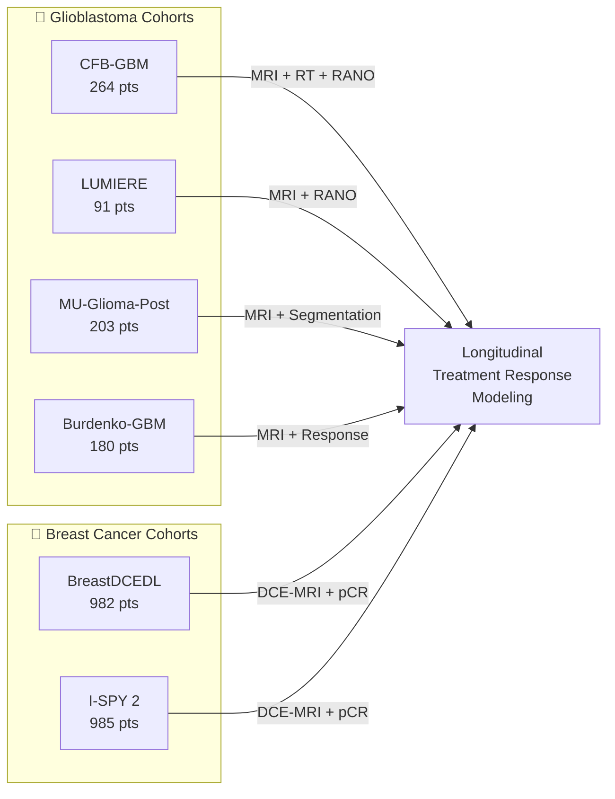

# Horizon Disentangled — Data Inventory

> **Last updated:** 2026-11-18  
> **Data root:** `/DATA/horizon_disentangled/data/`  
> **Total on disk:** ~139 GB (47 GB prior datasets + 92 GB I-SPY 2 MR DICOM)

This document describes every dataset managed in the Horizon Disentangled project: what was successfully downloaded, what medical and clinical information is available, the imaging modalities and formats, and what remains pending.

---

## Table of Contents

- [Overview](#overview)
- [1. CFB-GBM — Longitudinal Glioblastoma with Radiotherapy](#1-cfb-gbm--longitudinal-glioblastoma-with-radiotherapy)
- [2. LUMIERE — Longitudinal GBM with Expert RANO Ratings](#2-lumiere--longitudinal-gbm-with-expert-rano-ratings)
- [3. MU-Glioma-Post — Multi-Vendor Post-Treatment Glioma](#3-mu-glioma-post--multi-vendor-post-treatment-glioma)
- [4. Burdenko-GBM-Progression — GBM Treatment Response Tracking](#4-burdenko-gbm-progression--gbm-treatment-response-tracking)
- [5. BreastDCEDL_ISPY2 — Breast DCE-MRI Deep Learning Dataset](#5-breastdcedl_ispy2--breast-dce-mri-deep-learning-dataset)
- [6. I-SPY 2 Longitudinal — Breast Cancer Neoadjuvant Treatment Trajectories](#6-i-spy-2-longitudinal--breast-cancer-neoadjuvant-treatment-trajectories)
- [Download Status Summary](#download-status-summary)
- [Disk Space](#disk-space)

---

## Overview

The project assembles six publicly available medical imaging cohorts spanning two cancer domains — **glioblastoma** (brain) and **breast cancer** — chosen for their longitudinal structure (multiple imaging timepoints per patient during treatment).



| Domain | Cohort | Patients | Timepoints | Key Outcomes |
|--------|--------|----------|------------|--------------|
| Glioblastoma | CFB-GBM | 264 | t0, t1, t2 | Survival, RANO response |
| Glioblastoma | LUMIERE | 91 | 638 visits (avg 7/pt) | Survival, expert RANO |
| Glioblastoma | MU-Glioma-Post | 203 | 596 visits (avg 2.9/pt) | Tumor volumes |
| Glioblastoma | Burdenko-GBM | 180 | Up to 10 follow-ups | Treatment response, survival |
| Breast Cancer | BreastDCEDL_ISPY2 | 982 | 4–11 DCE phases | pCR, HR, HER2 |
| Breast Cancer | I-SPY 2 | 985 | T0→T1→T2→T3 | pCR, HR, HER2, MammaPrint |

---

## 1. CFB-GBM — Longitudinal Glioblastoma with Radiotherapy

> **DOI:** [10.7937/v9pn-2f72](https://doi.org/10.7937/v9pn-2f72) · **License:** CC BY 4.0 · **TCIA Version 3 (June 2026)**

### What We Have (Metadata Only — 2.7 MB)

**Path:** [`data/cfb_gbm/metadata/`](file:///DATA/horizon_disentangled/data/cfb_gbm/metadata/)

#### Clinical Data (`CFB-GBM_clinical_data_v03_20260619.tsv`)
- **264 patients** with newly diagnosed glioblastoma
- **Demographics:** Age (25–90 years, median ~60s), sex (158 M / 106 F), height, weight
- **Performance status:** WHO performance status (0–5 scale)
- **Survival:** Time from diagnosis to death in weeks (range: 3–238 weeks)
- **Treatment protocol:** WHO 2016 or 2021 guidelines

#### Treatment Data (`CFB-GBM_treatment_data_v02_20260129.tsv`)
- **Radiotherapy details** for all 264 patients
- Dose: 25–60 Gy across 5–33 fractions
- Delay from diagnosis to radiotherapy start (weeks)

#### RANO Response Criteria (`CFB-GBM_rano_criteria_v03_20260619.tsv`)
- **165 patients** with longitudinal tumor volume measurements at t0, t1, t2
- Tumor volume (cm³) at each timepoint
- RANO response classification between timepoints:
  - t0→t1: SD 81, PD 38, MR 24, PR 16, CR 1
  - t0→t2: SD 47, PD 30, PR 18, MR 17
  - t1→t2: SD 63, PD 30, MR 8, PR 6

#### MRI Availability (`CFB-GBM_mri_availability_v02_20260129.tsv`)
- **554 MRI visits** across 264 patients (t0: 264, t1: 170, t2: 120)
- **Scanners:** Siemens AERA 1.5T (510 visits), Siemens VIDA 3T (44 visits)
- **Sequences available:**

| Sequence | Description | Available |
|----------|-------------|-----------|
| T1Gd | T1-weighted with gadolinium contrast | 545/554 (98%) |
| FLAIR | Fluid-attenuated inversion recovery | 536/554 (97%) |
| T2* | T2-star susceptibility-weighted | 471/554 (85%) |
| T1eg | T1 without contrast | 423/554 (76%) |
| ADC | Apparent diffusion coefficient | 352/554 (64%) |
| T2 TSE | T2 turbo spin echo | 151/554 (27%) |
| T1 TSE | T1 turbo spin echo | 31/554 (6%) |

#### Pyradiomics Features (`CFB_GBM_features_extraction_pyradiomics_v03_20260619.tsv`)
- **2,424 feature rows** × 150 radiomic features for 261 patients
- Extracted from GTV (Gross Tumor Volume) masks across 7 MRI sequences
- Features include: shape, first-order statistics, GLCM, GLRLM, GLSZM, GLDM, NGTDM

#### CT Availability & Treatment Imaging
- CT scans for all 264 patients (planning CT for radiotherapy)
- GTV segmentation masks (97% complete), RT dose distributions, treatment machine logs

### What's Missing (Aspera Blocked)
- **208 GB NIfTI archive** (Package 1303): 3,981 skull-stripped, co-registered NIfTI volumes with GTV masks
- Requires Aspera FASP transfer (UDP blocked in current environment)

---

## 2. LUMIERE — Longitudinal GBM with Expert RANO Ratings

> **DOI:** [10.6084/m9.figshare.c.5904905.v1](https://doi.org/10.6084/m9.figshare.c.5904905.v1) · **License:** Public (Figshare)

### What We Have (Full Dataset — 31 GB) ✅

**Path:** [`data/lumiere/`](file:///DATA/horizon_disentangled/data/lumiere/)

#### Clinical & Demographics (`LUMIERE-Demographics_Pathology.csv`)
- **91 patients** with glioblastoma
- **Demographics:** Age at surgery (39–80 years), sex (47 male / 44 female)
- **Molecular markers:**
  - **IDH status:** Wild-type 56, unknown 23, IDH1 neg (sequencing required) 10, R132H mutant 1
  - **MGMT methylation:** Not methylated 43, methylated 37, unknown 11
- **Survival:** Time from surgery in weeks

#### Expert RANO Ratings (`LUMIERE-ExpertRating-v202211.csv`)
- **616 expert neuroradiologist RANO assessments** across all visits
- Rating distribution:
  - Progressive Disease (PD): 253
  - Post-Operative: 124
  - Stable Disease (SD): 97
  - Pre-Operative: 92
  - Complete Response (CR): 27
  - Partial Response (PR): 20
- Includes rating rationale (CRET/PRET for resection type, T2-Progression, Lesion info)

#### MRI Imaging (18,660 NIfTI files, 31 GB)
- **91 patients × 638 study dates** (average ~7 visits per patient)
- **Four skull-stripped MRI sequences per visit:**

| Sequence | Description | Available |
|----------|-------------|-----------|
| CT1 (T1+C) | T1-weighted post-contrast (gadolinium) | 632/638 (99%) |
| T2 | T2-weighted | 626/638 (98%) |
| T1 | T1-weighted pre-contrast | 617/638 (97%) |
| FLAIR | Fluid-attenuated inversion recovery | 612/638 (96%) |

- **Two automated segmentation pipelines per visit (599/638 visits):**
  - **DeepBraTumIA:** Brain mask, skull-stripped sequences, tumor segmentation mask, per-sequence segmentation masks, transformation files, measured tumor volumes (JSON)
  - **HD-GLIO-AUTO:** Registered skull-stripped sequences, brain masks, tumor segmentation in original and registered spaces

#### Data Completeness (`LUMIERE-datacompleteness.csv`)
- 638 entries tracking availability of each sequence and segmentation per visit

> [!NOTE]
> This is the most densely longitudinal glioblastoma dataset — with an average of 7 imaging timepoints per patient and expert RANO assessments for each, it is ideal for training treatment response trajectory models.

---

## 3. MU-Glioma-Post — Multi-Vendor Post-Treatment Glioma

> **DOI:** [10.7937/e1gq-q013](https://doi.org/10.7937/e1gq-q013) · **License:** CC BY 4.0

### What We Have (Metadata Only — 428 KB)

**Path:** [`data/mu_glioma_post/`](file:///DATA/horizon_disentangled/data/mu_glioma_post/)

#### Clinical Data (`MU-Glioma-Post_ClinicalData-July2025.xlsx`)
- **203 patients** with post-treatment glioma (596 visits, avg 2.9/patient)
- Data dictionary format listing available clinical fields:
  - **Demographics:** Sex at birth, race, age at diagnosis
  - **Diagnosis:** Primary diagnosis categories (Pilocytic astrocytoma, Astrocytoma, Oligodendroglioma, Neurocytoma, Glioneural, Diffuse glioma, Glioma with GBM features, GBM)
  - **Tumor grade:** Grades 1–4
- **Multi-vendor, multi-field-strength** acquisition across 4 scanner manufacturers at 1.5T and 3T

#### Segmentation Volumes (`MU-Glioma-Post_Segmentation_Volumes.xlsx`)
- **334 segmentation volume entries** for 173 patients
- Preprocessed with **FeTS pipeline** to 1 mm³ SRI24 atlas space
- Volumes and intensity statistics for 4 MRI sequences:
  - `brain_t1c` — T1 post-contrast
  - `brain_t1n` — T1 native (pre-contrast)
  - `brain_t2f` — T2 FLAIR
  - `brain_t2w` — T2 weighted
- Mean and standard deviation of voxel intensities per tumor compartment

### What's Missing (Aspera Blocked)
- **11 GB NIfTI archive** (Package 1030): Skull-stripped volumes with four-compartment tumor segmentation labels:
  1. Non-enhancing tumor core
  2. FLAIR hyperintensity / edema
  3. Enhancing tissue
  4. Surgical resection cavity

> [!IMPORTANT]
> The key value of this dataset is **multi-vendor heterogeneity** — it stresses technical confounder disentanglement across different scanner manufacturers and field strengths, which is central to the Horizon Disentangled project goals.

---

## 4. Burdenko-GBM-Progression — GBM Treatment Response Tracking

> **DOI:** [10.7937/d4a4-7f79](https://doi.org/10.7937/d4a4-7f79) · **License:** CC BY 4.0 (clinical CSV) / NIH Controlled Access (DICOM)

### What We Have (Metadata Only — 1.4 MB)

**Path:** [`data/burdenko_gbm/`](file:///DATA/horizon_disentangled/data/burdenko_gbm/)

#### Clinical Data (`Burdenko-GBM-clinical-data_20230410.csv`)
- **180 patients** with glioblastoma from the Burdenko Neurosurgical Center (Russia)
- **Demographics:** Age (8–85 years), sex (97 M / 81 F)
- **Molecular markers:**
  - **IDH1/2 status:** Negative 101, positive 13 (66 unknown)
  - **MGMT methylation:** Negative 57, positive 37 (86 unknown)
- **Treatment timeline (anonymized dates):**
  - Date of surgery
  - Radiotherapy start and end dates
  - Topometric MRI date
- **Longitudinal treatment response** at up to 10 follow-up timepoints:
  - Response categories: `response`, `stable`, `progression`, `pseudo progression`, `distant progression`
  - Response at 1st follow-up: Response 86, Stable 40, Pseudo-progression 31, Progression 20
  - Progressive loss to follow-up: 178 → 151 → 112 → 73 → 51 → 36 → 20 → 16 → 10 → 5
- **Date of death** (when available) for overall survival analysis

#### CRDC Manifest (`GC_manifest_Burdenko-GBM-Progression.csv`)
- 4,956 DICOM files catalogued across 180 patients
- File types include MRI, CT, RT Structure, RT Dose

### What's Missing (NIH DUA Required)
- **131 GB raw DICOM** including MRI + CT + RT structure sets
- Requires NIH Controlled Data Access approval (potential facial reconstruction risk)
- 4 scanner vendors represented for multi-vendor robustness testing

---

## 5. BreastDCEDL_ISPY2 — Breast DCE-MRI Deep Learning Dataset

> **DOI:** [10.7937/42WQ-TH78](https://doi.org/10.7937/42WQ-TH78) · **License:** CC BY 4.0

### What We Have (Metadata + Code + MinCrop — 14 GB) ✅

**Path:** [`data/breastdcedl_ispy2/`](file:///DATA/horizon_disentangled/data/breastdcedl_ispy2/)

#### Clinical Metadata (`BreastDCEDL_ISPY2_full_metadata.tsv`)
- **982 patients** from the I-SPY 2 trial with breast cancer
- **Age:** 23–77 years
- **Receptor status:**
  - HR+/HER2−: 381 (39%)
  - Triple Negative: 359 (37%)
  - HER2+: 242 (25%)
- **Pathologic Complete Response (pCR):** Yes 316 (32%), No 666 (68%)
- **Treatment arms** (13 combinations), top 5:
  - Paclitaxel alone: 178 (18%)
  - Paclitaxel + AMG 386: 115
  - Paclitaxel + Neratinib: 113
  - Paclitaxel + Ganitumab: 106
  - Paclitaxel + Ganetespib: 93
- **Individual drug flags:** Neratinib, Pembrolizumab, Trastuzumab, Ganitumab, Ganetespib, MK-2206, T-DM1, Pertuzumab, Carboplatin, ABT-888, AMG-386
- **MRI metadata:** Image dimensions (n_xy, n_z), number of DCE timepoints (4–11), slice thickness (0.8–3.0 mm), pixel spacing (0.5–1.1 mm), tumor bounding box coordinates, tumor volume

#### Data Dictionary (`BreastDCEDL_DataDictionary.tsv`)
- 49-column definitions with types and value ranges

#### File Size Manifest (`BreastDCEDL_ISPY2_files_sizes.tsv`)
- 7,039 individual NIfTI file entries with sizes and dimensions

#### GitHub Code Repository (2.1 GB)
**Path:** [`data/breastdcedl_ispy2/BreastDCEDL_code/`](file:///DATA/horizon_disentangled/data/breastdcedl_ispy2/BreastDCEDL_code/)
- DICOM-to-NIfTI conversion pipeline
- Vision Transformer (ViT) baseline model for pCR prediction
- Training scripts and utilities

#### Zenodo MinCrop Benchmark (11.7 GB) ✅
**Path:** [`data/breastdcedl_ispy2/zenodo_mincrop/`](file:///DATA/horizon_disentangled/data/breastdcedl_ispy2/zenodo_mincrop/)

| Component | Files | Size | Description |
|-----------|-------|------|-------------|
| `BreastDCEDL_duke/` | 2,765 | 8.4 GB | Duke University breast DCE-MRI (256×256 tumor-cropped) |
| `BreastDCEDL_spy1/` | 713 | 3.0 GB | I-SPY 1 breast DCE-MRI (256×256 tumor-cropped) |
| `BreastDCEDL_models/` | 2 | 328 MB | Pre-trained ViT model weights |

> [!NOTE]
> The MinCrop dataset pools **2,070 patients** across three cohorts (I-SPY 1, I-SPY 2, Duke) in a standardized 256×256 tumor-cropped format, ready for direct model training. All Zenodo downloads verified against API checksums.

### What's Missing (Aspera Blocked)
- **54 GB full-resolution NIfTI** (Package 1158): Full 3D DCE-MRI volumes (`<patientID>_acq<N>.nii.gz`) with binary tumor masks, 3–12 pre/post-contrast phases per exam

---

## 6. I-SPY 2 Longitudinal — Breast Cancer Neoadjuvant Treatment Trajectories

> **DOI:** [10.7937/TCIA.D8Z0-9T85](https://doi.org/10.7937/TCIA.D8Z0-9T85) · **License:** CC BY 4.0

### What We Have (Metadata + SEG + MR DICOM — 94 GB) ✅

**Path:** [`data/ispy2_longitudinal/`](file:///DATA/horizon_disentangled/data/ispy2_longitudinal/)

#### Clinical Data (`ISPY2-Imaging-Cohort-1-Clinical-Data.xlsx`)
- **985 patients** from the I-SPY 2 adaptive randomization trial
- **Age:** 23–77 years
- **Receptor status:**
  - HR+: 537 (55%), HR−: 448 (45%)
  - HER2+: 244 (25%), HER2−: 741 (75%)
- **Pathologic Complete Response (pCR):** Yes 317 (32%), No 668 (68%)
- **MammaPrint (MP) genomic risk:** Available for all patients (binary high/low)
- **Treatment arms** (13 combinations, same as BreastDCEDL):
  - Paclitaxel (control): 178
  - + AMG 386: 115, + Neratinib: 114, + Ganitumab: 106, + Ganetespib: 93
- **Race:** White 780, Black/African American 118, Asian 68, Other 15
- **Menopausal status and ethnicity** recorded

#### Multi-Feature MRI NACT Data (`Multi-feature-MRI-NACT-Data.xlsx`)
- **384 patients** with quantitative longitudinal MRI features across 4 timepoints:
  - **Functional Tumor Volume (FTV):** At baseline (V10/V20/V30/V40 thresholds) — measures enhancing tumor
  - **Tumor Sphericity:** At T0, T1, T2, T3 — shape descriptor
  - **Longest Diameter (LD):** At T0, T1, T2, T3 — RECIST-like measurement
  - **Background Parenchymal Enhancement (BPE):** 5-slice mean at each timepoint
  - **Percent change metrics:** FTV, Sphericity, LD, BPE change from T0 to T1/T2/T3

#### Treatment Timeline (4 visits)
The I-SPY 2 trial protocol defines 4 imaging timepoints during neoadjuvant chemotherapy:

| Timepoint | Timing | Treatment Phase |
|-----------|--------|-----------------|
| **T0** | Baseline (pre-treatment) | Before any chemotherapy |
| **T1** | ~3 weeks | During Paclitaxel ± experimental agent |
| **T2** | ~12 weeks (inter-regimen) | Switch to Anthracycline/Cyclophosphamide (AC) |
| **T3** | ~24 weeks (pre-surgery) | After completing neoadjuvant chemotherapy |

#### IDC Filtered Series Manifest (`idc_filtered_series.csv`)
- **32,415 series** filtered from the full 2.41 TB I-SPY 2 DICOM archive
- Includes only: SEG masks + derived kinetic maps (PEearly, PElate, SER) + DWI + T2
- **Modalities:** MR 27,514 series (1,017 GB) + SEG 4,901 series (33 GB)
- **Collections:** `ispy2` (18,081 series, 719 patients) + `acrin_6698` (14,334 series, 266 patients)

#### SEG Segmentation Masks (4,661 DICOM files, 2.3 GB) ✅

| Directory | Patients | DICOM Files | Description |
|-----------|----------|-------------|-------------|
| `dicom_seg_50/` | 50 | 296 | Initial pilot download |
| `dicom_seg_longitudinal/` | 928 | 4,365 | All longitudinal patients (>1 timepoint) |

- **928 unique patients** with tumor segmentation masks across multiple visits
- SEG DICOM objects containing binary/fractional tumor masks for volumetric analysis
- Downloaded via IDC S3 at ~100 MB/s

#### MR DICOM Series (92 GB, 1,341,408 files) ✅

**Path:** [`data/ispy2_longitudinal/dicom_mr/`](file:///DATA/horizon_disentangled/data/ispy2_longitudinal/dicom_mr/)

| Field | Value |
|-------|-------|
| Patients downloaded | 387 (longitudinal, >1 timepoint) |
| Total series | 7,496 |
| Total DICOM files | 1,341,408 |
| Disk size | 92 GB (manifest estimated 200 GB; DICOM compression) |
| Avg studies/patient | 3.7 |
| Download time | 45 minutes at ~76 MB/s via IDC S3 |
| Output directory | `data/ispy2_longitudinal/dicom_mr/` |

**Available MR series types (across all patients):**

| Series Description | Count | Description |
|--------------------|-------|-------------|
| VOLSER: uni-lateral cropped: original DCE | 3,163 | Original dynamic contrast-enhanced MRI |
| VOLSER: uni-lateral cropped: SER | 3,163 | Signal Enhancement Ratio parametric map |
| VOLSER: uni-lateral cropped: PE2 | 3,153 | Peak Enhancement at early timepoint |
| VOLSER: uni-lateral cropped: PE6 | 1,658 | Peak Enhancement at late timepoint |
| VOLSER: uni-lateral cropped: PE5 | 1,482 | Peak Enhancement at intermediate timepoint |
| VOLSER: bi-lateral: SER | 635 | Bilateral SER map |
| VOLSER: bi-lateral: original DCE | 635 | Bilateral original DCE |
| Ax T2 FSE FS | 444 | Axial T2 fat-suppressed |
| AX T2 FSE BILATERAL PRE | 427 | Bilateral T2 FSE pre-contrast |
| DWI TRACE | 380 | Diffusion-weighted imaging |
| ADC | 380 | Apparent Diffusion Coefficient map |

> [!TIP]
> The **SER (Signal Enhancement Ratio)** and **PE (Peak Enhancement)** maps are pre-computed kinetic parameters derived from the multi-phase DCE-MRI. They encode tumor vascular physiology and are significantly more compact than the raw 4D DCE data, while retaining the pharmacokinetic information needed for treatment response prediction.

---

## Download Status Summary

### ✅ Successfully Downloaded

| Dataset | Type | Size | Files |
|---------|------|------|-------|
| CFB-GBM metadata | 8 TSV (clinical, treatment, RANO, MRI, CT, pyradiomics) | 2.7 MB | 8 |
| LUMIERE full | 4 MRI sequences + 2 automated segmentations + 3 CSV | 31 GB | 18,660 NIfTI + metadata |
| MU-Glioma-Post metadata | Clinical data + segmentation volumes | 428 KB | 2 |
| Burdenko-GBM metadata | Clinical CSV + CRDC manifest | 1.4 MB | 2 |
| BreastDCEDL metadata | Full metadata + data dictionary + file sizes | 744 KB | 3 |
| BreastDCEDL code | GitHub repo (DICOM→NIfTI + ViT baseline) | 2.1 GB | repo |
| BreastDCEDL MinCrop | Zenodo 256×256 tumor-cropped (Duke + SPY1 + models) | 11.7 GB | 3,480 |
| I-SPY 2 metadata | Clinical + Multi-feature MRI + Data Dictionary | 455 KB | 3 |
| I-SPY 2 IDC manifest | Filtered series (SEG + PE + SER + DWI + T2) | 17 MB | 1 |
| I-SPY 2 SEG masks | 978 patients' segmentation DICOM | 2.3 GB | 4,661 |
| I-SPY 2 MR DICOM | 387 patients × 7,496 series (DCE, SER, PE, DWI, T2) | 92 GB | 1,341,408 |

### 🔄 In Progress

*None — all selected downloads complete.*

### ❌ Not Downloaded

| Dataset | Size | Reason |
|---------|------|--------|
| CFB-GBM NIfTI (3,981 volumes) | 208 GB | Aspera UDP blocked + exceeds original disk |
| MU-Glioma-Post NIfTI (4-seq + seg) | 11 GB | Aspera UDP blocked |
| BreastDCEDL full NIfTI (3D DCE + masks) | 54 GB | Aspera UDP blocked |
| Burdenko-GBM DICOM (MRI + CT + RT) | 131 GB | NIH DUA required |
| I-SPY 2 full MR (all 963 longitudinal pts) | 974 GB | Exceeds available disk |
| LUMIERE CoLlAGe radiomics | 50.5 GB | Optional, low priority |

---

## Disk Space

```
Filesystem: bigdata/lxc/subvol-16501-disk-1
Total: 700 GB | Used: 360 GB | Available: 341 GB | Usage: 52%

Data directory breakdown:
  92  GB  data/ispy2_longitudinal/ (387-pt MR DICOM + 978-pt SEG + metadata)
  31  GB  data/lumiere/            (18,660 NIfTI + metadata)
  14  GB  data/breastdcedl_ispy2/  (code repo + Zenodo MinCrop + metadata)
  2.7 MB  data/cfb_gbm/            (metadata only)
  428 KB  data/mu_glioma_post/     (metadata only)
  321 KB  data/burdenko_gbm/       (metadata only)
  ─────────────────────────────────
  139 GB  TOTAL project data
```

---

## Medical Information Summary by Dataset

### Glioblastoma Cohorts — Clinical Variables

| Variable | CFB-GBM | LUMIERE | MU-Glioma-Post | Burdenko-GBM |
|----------|---------|---------|----------------|--------------|
| **N patients** | 264 | 91 | 203 | 180 |
| **Age range** | 25–90 | 39–80 | Available | 8–85 |
| **Sex** | 158M/106F | 47M/44F | Available | 97M/81F |
| **IDH status** | — | WT 56, Mut 1 | — | Neg 101, Pos 13 |
| **MGMT methylation** | — | Unmeth 43, Meth 37 | — | Neg 57, Pos 37 |
| **Survival** | ✅ (3–238 wks) | ✅ | — | ✅ (date of death) |
| **WHO performance** | ✅ (0–5) | — | — | — |
| **RANO response** | ✅ (165 pts) | ✅ (616 ratings) | — | — |
| **Treatment response** | — | — | — | ✅ (up to 10 FU) |
| **Radiotherapy** | ✅ (dose, fractions) | — | — | ✅ (dates) |
| **Tumor volumes** | ✅ (at t0/t1/t2) | ✅ (automated) | ✅ (4-compartment) | — |
| **Radiomic features** | ✅ (150 pyradiomics) | — | — | — |
| **Scanner info** | ✅ (Siemens 1.5T/3T) | — | ✅ (multi-vendor) | ✅ (4 vendors) |

### Breast Cancer Cohorts — Clinical Variables

| Variable | BreastDCEDL_ISPY2 | I-SPY 2 Longitudinal |
|----------|-------------------|---------------------|
| **N patients** | 982 | 985 |
| **Age range** | 23–77 | 23–77 |
| **HR status** | Pos 536 / Neg 446 | Pos 537 / Neg 448 |
| **HER2 status** | Pos 242 / Neg 740 | Pos 244 / Neg 741 |
| **Subtype** | HR+/HER2− 381, TN 359, HER2+ 242 | Available |
| **pCR** | Yes 316 (32%) / No 666 | Yes 317 (32%) / No 668 |
| **MammaPrint** | — | ✅ (binary risk) |
| **Treatment arm** | ✅ (13 arms, drug flags) | ✅ (13 arms) |
| **Race** | ✅ | ✅ (White 780, Black 118, Asian 68) |
| **Menopausal status** | ✅ | ✅ |
| **Tumor volume** | ✅ (voxel-based) | ✅ (FTV at 4 thresholds) |
| **Longitudinal features** | — | ✅ (FTV, sphericity, LD, BPE at T0–T3) |
| **DCE timepoints** | 4–11 phases/exam | 4 visits (T0–T3) |
| **Kinetic maps** | — | ✅ (SER, PE2, PE5, PE6) |
| **DWI/ADC** | — | ✅ (380 series) |

---

## Data Formats Reference

| Format | Used By | Description |
|--------|---------|-------------|
| **NIfTI (.nii.gz)** | LUMIERE, CFB-GBM*, MU-Glioma*, BreastDCEDL* | 3D/4D neuroimaging standard, compressed |
| **DICOM (.dcm)** | I-SPY 2, Burdenko* | Medical imaging standard with embedded metadata |
| **DICOM SEG** | I-SPY 2 | Segmentation objects following DICOM standard |
| **TSV** | CFB-GBM, BreastDCEDL | Tab-separated clinical/radiomic tables |
| **CSV** | LUMIERE, Burdenko | Comma-separated clinical data |
| **XLSX** | MU-Glioma-Post, I-SPY 2 | Excel clinical data and MRI features |
| **PDF** | LUMIERE, I-SPY 2 | Data dictionaries and documentation |
| **JSON** | LUMIERE (DeepBraTumIA) | Measured tumor volumes |

*\* Format for imaging data not yet downloaded*

---

## Licensing & Access

| Dataset | License | Access Level | Authentication |
|---------|---------|--------------|----------------|
| CFB-GBM | CC BY 4.0 | Open | None |
| LUMIERE | Public (Figshare) | Open | None |
| MU-Glioma-Post | CC BY 4.0 | Open | None |
| Burdenko-GBM (clinical) | CC BY 4.0 | Open | None |
| Burdenko-GBM (DICOM) | Controlled | NIH DUA | CRDC API key |
| BreastDCEDL_ISPY2 | CC BY 4.0 | Open | None |
| I-SPY 2 | CC BY 4.0 | Open | None (IDC S3) |
