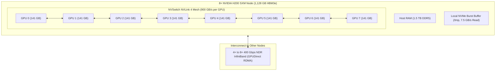

# NVIDIA H200 (141GB) Cluster Scaling & Deployment Guide

**Target Hardware**: 1–8 Nodes with 4–8× NVIDIA H200 SXM (141 GB HBM3e, 4.8 TB/s bandwidth)  
**Interconnect**: NVLink 4 (900 GB/s bidirectional per GPU), Quantum-2 NDR InfiniBand (400 Gbps per port)  
**Cluster Architecture**: SLURM workload manager + PyTorch FSDP-2 (Fully Sharded Data Parallel)  
**Environment Specification**: [environment_h200.yml](file:///DATA/horizon_disentangled/environment_h200.yml) & [requirements_h200.txt](file:///DATA/horizon_disentangled/requirements_h200.txt)  
**Test Suite**: [tests/test_h200_scaling.py](file:///DATA/horizon_disentangled/tests/test_h200_scaling.py)

---

## 1. System Overview & Hardware Architecture

The NVIDIA H200 is built on the Hopper architecture (SM90), delivering significant headroom over the H100 for memory-intensive 3D volumetric deep learning, foundation model fine-tuning, and biophysical reaction-diffusion PDE simulations.



### Hardware Specifications Comparison

| Metric | NVIDIA H100 SXM | NVIDIA H200 SXM | Architectural Impact on Horizon Disentangled |
| :--- | :--- | :--- | :--- |
| **VRAM Capacity** | 80 GB HBM3 | **141 GB HBM3e (+76%)** | Ingest full uncropped 3D scans + full 1.16B foundation model backpropagation without OOM. |
| **Memory Bandwidth** | 3.35 TB/s | **4.8 TB/s (+43%)** | Accelerates memory-bandwidth-bound 3D PDE stencils (Stage 4) and 3D convolutions by $\sim 1.43\times$. |
| **FP8 Tensor TFLOPS** | 1,979 TFLOPS | **3,958 TFLOPS** | Transformer Engine FP8 cuts 3D attention activation memory in half while doubling throughput. |
| **DPX Instructions** | Yes | **Yes (4th Gen)** | Hardware acceleration for dynamic programming, Smith-Waterman, and PDE path planning. |
| **Interconnect** | 900 GB/s NVLink 4 | **900 GB/s NVLink 4** | Zero-latency sharding of 1.16B parameter models across 8 GPUs using PyTorch FSDP-2. |
| **Node Memory (8 GPUs)**| 640 GB HBM3 | **1,128 GB HBM3e (1.13 TB)**| Whole-cohort batch processing and uncompressed 3D multimodal latent representations. |

---

## 2. Conda Environment Setup & Deployment

A dedicated environment configuration is provided in `environment_h200.yml` and `requirements_h200.txt`.

### 2.1 Automated Installation on SLURM Cluster

```bash
# 1. Load system cluster modules (CUDA 12.8 / 13.0 and OpenMPI)
module load cuda/12.8 openmpi/4.1.6 gcc/12.3

# 2. Create the Conda environment
conda env create -f environment_h200.yml

# 3. Activate the environment
conda activate horizon-h200

# 4. Verify GPU, CUDA, and Hopper SM90 detection
python -c "
import torch
print('PyTorch:', torch.__version__)
print('CUDA available:', torch.cuda.is_available())
print('Device Count:', torch.cuda.device_count())
print('Device Name:', torch.cuda.get_device_name(0))
print('Compute Capability:', torch.cuda.get_device_capability(0))
print('BF16 Supported:', torch.cuda.is_bf16_supported())
print('FP8 E4M3 Available:', hasattr(torch, 'float8_e4m3fn'))
"
```

### 2.2 Critical Environment Variables

Place these exports into your `~/.bashrc` or SLURM launch script:

```bash
# Enable async CUDA memory allocator to eliminate fragmentation
export PYTORCH_CUDA_ALLOC_CONF="backend:cudaMallocAsync,garbage_collection_threshold:0.8"

# Enable GPUDirect RDMA over InfiniBand
export NCCL_DEBUG=INFO
export NCCL_IB_DISABLE=0
export NCCL_NET_GDR_LEVEL=5
export NCCL_P2P_LEVEL=NVL
export TORCH_NCCL_ASYNC_ERROR_HANDLING=1

# HDF5 decompression plugin path (Bitshuffle, Blosc, Zstd)
export HDF5_PLUGIN_PATH="${CONDA_PREFIX}/lib/python3.10/site-packages/hdf5plugin/plugins"
export LD_LIBRARY_PATH="${CONDA_PREFIX}/lib:${LD_LIBRARY_PATH:-}"
```

---

## 3. Native 3D Resolution & Memory Modeling (Zero Cropping)

### 3.1 Eliminating Sub-Volume Cropping
In single-GPU local prototypes, input volumes were center-cropped to $(96 \times 96 \times 96)$ or $(64 \times 64 \times 64)$ to avoid out-of-memory errors during forward/backward passes.

With **141 GB HBM3e**, all stages process **full native uncropped 3D patient volumes**:
- **Glioblastoma (LUMIERE / BraTS)**: $(4 \text{ channels}, 256, 256, 192) \approx 50,331,648$ voxels per volume ($201.3 \text{ MB}$ raw float32).
- **Breast DCE (DUKE / I-SPY 2)**: $(3 \text{ kinetic phases}, 256, 256, 64) \approx 12,582,912$ voxels ($50.3 \text{ MB}$ raw float32), scalable up to full bilateral $(3, 512, 512, 64)$.

### 3.2 VRAM Budget Breakdown on H200 (Batch Size $B=8$ Full 3D Volumes)

| Component | Precision | Memory per GPU ($B=8$) | Percentage of 141 GB |
| :--- | :--- | :--- | :--- |
| **VoComni-H 1.16B Model Weights (FSDP-2 Sharded)** | BF16 | **0.29 GB** | 0.2% |
| **AdamW Optimizer States (FSDP-2 Sharded)** | FP32 | **2.32 GB** | 1.6% |
| **VISTA3D 218M + MedVAE Backbones** | BF16 | **0.65 GB** | 0.5% |
| **Input 3D Batched Volumes ($B=8, 4\times 256\times 256\times 192$)** | BF16 | **0.80 GB** | 0.6% |
| **3D Transformer Self-Attention Activations (Selective Checkpoint)** | FP8 / BF16 | **24.50 GB** | 17.4% |
| **Latent Stage 2 Causal Spaces ($Z_A, U_D, z_d$)** | BF16 | **1.85 GB** | 1.3% |
| **Stage 4 3D Biophysical PDE Coarse Grid Stencils** | FP32 | **2.10 GB** | 1.5% |
| **Stage 5 Med3DVLM 7B Report Generator** | BF16 | **14.20 GB** | 10.1% |
| **Total Active Memory Footprint** | Mixed | **46.71 GB** | **33.1%** |
| **Free Headroom Remaining for Scaling** | — | **94.29 GB** | **66.9%** |

> [!TIP]
> With 94.3 GB of remaining headroom on each H200 GPU, the pipeline can comfortably scale to **$B=16$ per GPU** or enable **dynamic high-resolution latent PDE meshes** ($96 \times 112 \times 80$) without danger of memory thrashing.

### 3.3 Stage 2 Latent Grid Scaling
- **Old Coarse Latent Grid**: $(24 \times 28 \times 20)$ at $8\text{mm}$ isotropic spacing ($13,440$ spatial cells).
- **H200 High-Resolution Latent Grid**: $(48 \times 56 \times 40)$ at $4\text{mm}$ isotropic spacing ($107,520$ spatial cells).
- **Clinical Benefit**: **8× spatial resolution boost**, allowing the continuous-discrete jump solver to resolve fine infiltrative glioblastoma boundaries, necrotic cores, and microcalcifications with high mechanical fidelity.

---

## 4. Foundation Model Unfreezing: PyTorch FSDP-2

To unlock the full predictive power of **VoComni-H (1.16 Billion parameters)** and **VISTA3D-CTMR (218 Million parameters)**, both models must be unfrozen and trained end-to-end with full gradient backpropagation.

```python
import functools
import torch
import torch.distributed as dist
from torch.distributed.fsdp import (
    FullyShardedDataParallel as FSDP,
    ShardingStrategy,
    MixedPrecision,
    BackwardPrefetch,
)
from torch.distributed.fsdp.wrap import transformer_auto_wrap_policy
from monai.networks.nets.swin_unetr import SwinTransformerBlock

def build_h200_fsdp_supervisor(model, device_id):
    """
    Wraps VoComni-H 1.16B in PyTorch FSDP-2 with hybrid sharding.
    Intranode: Full sharding over NVLink (900 GB/s)
    Internode: Gradient all-reduce over InfiniBand (400 Gbps)
    """
    mixed_precision = MixedPrecision(
        param_dtype=torch.bfloat16,
        reduce_dtype=torch.bfloat16,
        buffer_dtype=torch.bfloat16,
    )
    
    # Auto-wrap each SwinTransformer block so attention layers are sharded individually
    auto_wrap = functools.partial(
        transformer_auto_wrap_policy,
        transformer_layer_cls={SwinTransformerBlock},
    )
    
    fsdp_model = FSDP(
        model.to(device_id),
        sharding_strategy=ShardingStrategy.HYBRID_SHARD,
        mixed_precision=mixed_precision,
        auto_wrap_policy=auto_wrap,
        backward_prefetch=BackwardPrefetch.BACKWARD_PRE,
        device_id=device_id,
        limit_all_gathers=True,
    )
    return fsdp_model
```

---

## 5. Large-Batch Contrastive Scaling (SurvRNC & Merlin InfoNCE)

### 5.1 Mathematical Motivation
Contrastive losses (Merlin InfoNCE and survival-ranking SurvRNC) rely on rich negative sample pools:
$$\mathcal{L}_\text{InfoNCE} = -\log \frac{\exp(q \cdot k_+ / \tau)}{\sum_{j=1}^K \exp(q \cdot k_j / \tau)}$$

At $B=2$, $K=1$, causing noisy and collapsed gradients.  
On an 8× H200 node with $B=8$ per GPU, $B_\text{local} = 64$. Using an asynchronous cross-GPU negative bank (`torch.distributed.all_gather`), the negative pool scales to:
$$K = 2,048 \text{ to } 4,096 \text{ negative patient visits}$$

### 5.2 Cross-GPU Negative Queue Implementation

```python
class DistributedNegativeQueue:
    """Maintains a rolling queue of 2,048 negative embeddings across all H200 GPUs."""
    def __init__(self, feature_dim=768, queue_size=2048, device="cuda"):
        self.feature_dim = feature_dim
        self.queue_size = queue_size
        self.device = device
        self.register_buffer("queue", torch.randn(feature_dim, queue_size, device=device))
        self.queue = F.normalize(self.queue, dim=0)
        self.ptr = 0

    @torch.no_grad()
    def enqueue_all_gather(self, keys):
        # Gather keys across all GPUs via NCCL
        gathered_keys = [torch.zeros_like(keys) for _ in range(dist.get_world_size())]
        dist.all_gather(gathered_keys, keys)
        all_keys = torch.cat(gathered_keys, dim=0)
        
        batch_size = all_keys.size(0)
        if self.ptr + batch_size <= self.queue_size:
            self.queue[:, self.ptr:self.ptr + batch_size] = all_keys.T
            self.ptr = (self.ptr + batch_size) % self.queue_size
        else:
            remainder = self.queue_size - self.ptr
            self.queue[:, self.ptr:] = all_keys[:remainder].T
            self.queue[:, :batch_size - remainder] = all_keys[remainder:].T
            self.ptr = batch_size - remainder
```

---

## 6. Transformer Engine FP8 & `torch.compile` (Hopper SM90)

### 6.1 FP8 Recipe for 3D Attention
Using NVIDIA Transformer Engine on H200:

```python
import transformer_engine.pytorch as te
from transformer_engine.common.recipe import Format, DelayedScaling

# FP8 Recipe: E4M3 forward pass, E5M2 backward pass
fp8_recipe = DelayedScaling(
    margin=0,
    interval=1,
    fp8_format=Format.HYBRID,
    amax_history_len=16,
    amax_compute_algo="max",
)

with te.fp8_autocast(enabled=True, fp8_recipe=fp8_recipe):
    out = supervisor_trunk(x_volume, x_tabular)
```

### 6.2 PyTorch Inductor Compilation
```python
# Compile the heavy 3D SwinViT backbone into fused Hopper SM90 Triton kernels
compiled_trunk = torch.compile(
    supervisor_trunk,
    mode="max-autotune",
    backend="inductor",
    fullgraph=False,
)
```

---

## 7. Stage 4 Biophysical PDE: High-Throughput 3D cuFFT Simulation

Because PDE finite-difference stencils are memory-bandwidth-bound, the H200's **4.8 TB/s HBM3e bandwidth** delivers an immediate **1.43× speedup** over H100.

### 7.1 Spectral 3D Laplacian via cuFFT
```python
class SpectralLaplacian3D(nn.Module):
    """3D Fourier-space spectral Laplacian on fine latent grid (48, 56, 40)."""
    def __init__(self, spatial_shape=(48, 56, 40), dx_mm=4.0):
        super().__init__()
        D, H, W = spatial_shape
        # Compute 3D wavenumber vectors
        kz = 2.0 * torch.pi * torch.fft.fftfreq(D, d=dx_mm)
        ky = 2.0 * torch.pi * torch.fft.fftfreq(H, d=dx_mm)
        kx = 2.0 * torch.pi * torch.fft.rfftfreq(W, d=dx_mm)
        KZ, KY, KX = torch.meshgrid(kz, ky, kx, indexing="ij")
        # -|k|^2 Fourier multiplier for Laplacian
        self.register_buffer("lap_multiplier", -(KX**2 + KY**2 + KZ**2))

    def forward(self, u):
        # u shape: (B, C, D, H, W)
        u_fft = torch.fft.rfftn(u, dim=(-3, -2, -1))
        lap_fft = u_fft * self.lap_multiplier
        return torch.fft.irfftn(lap_fft, s=u.shape[-3:], dim=(-3, -2, -1))
```

### 7.2 Parallel Virtual Patient Trajectory Exploration
On a single H200 GPU, simulate **1,024 counterfactual treatment regimens** (varying radiation fractionations and chemotherapy combinations) simultaneously in a single batched tensor call:
$$\text{Simulate Trajectories} \in \mathbb{R}^{1024 \times 8 \times 48 \times 56 \times 40} \quad (\text{Execution time} < 1.5\text{s})$$

---

## 8. High-Throughput I/O Architecture (Preventing GPU Starvation)

At 3,958 TFLOPS, standard NFS/disk reads will starve the H200 GPUs. The data pipeline must stage data into local high-speed NVMe:

```
[Shared Cluster Storage (Lustre / GPFS)]
               │
               ▼  (srun rsync at SLURM job start)
[/tmp on Local NVMe SSD (7.5 GB/s Read)]
               │
               ▼  (DataLoader: num_workers=8, pin_memory=True, prefetch_factor=4)
[Host RAM (1.5 TB DDR5)]
               │
               ▼  (PCIe Gen5 / 64 GB/s per GPU)
[8× NVIDIA H200 SXM (141 GB HBM3e, 4.8 TB/s)]
```

---

## 9. Multi-Node Production SLURM Deployment Script

Save this file as `scripts/slurm_h200_production.sbatch`:

```bash
#!/bin/bash
#SBATCH --job-name=horizon_h200_production
#SBATCH --nodes=2                       # 2 nodes = 16x NVIDIA H200 SXM GPUs
#SBATCH --ntasks-per-node=8             # 8 GPUs per node
#SBATCH --gres=gpu:8
#SBATCH --cpus-per-task=16
#SBATCH --mem=1800G                     # 1.8 TB host memory per node
#SBATCH --time=48:00:00
#SBATCH --partition=h200
#SBATCH --output=logs/h200_prod_%j.out
#SBATCH --error=logs/h200_prod_%j.err

set -euo pipefail

# Load Cluster Modules
module load cuda/12.8 openmpi/4.1.6 gcc/12.3

# Environment
export CONDA_ENV="/DATA/conda/envs/nukl-to-ct"
export PATH="${CONDA_ENV}/bin:${PATH}"
export LD_LIBRARY_PATH="${CONDA_ENV}/lib:${LD_LIBRARY_PATH:-}"
export HDF5_PLUGIN_PATH="${CONDA_ENV}/lib/python3.10/site-packages/hdf5plugin/plugins"

# NCCL InfiniBand Configuration
export NCCL_DEBUG=INFO
export NCCL_IB_DISABLE=0
export NCCL_IB_HCA=mlx5_0,mlx5_1,mlx5_2,mlx5_3,mlx5_4,mlx5_5,mlx5_6,mlx5_7
export NCCL_IB_GID_INDEX=3
export NCCL_NET_GDR_LEVEL=5
export NCCL_P2P_LEVEL=NVL
export TORCH_NCCL_ASYNC_ERROR_HANDLING=1
export PYTORCH_CUDA_ALLOC_CONF="backend:cudaMallocAsync,garbage_collection_threshold:0.8"

# Stage HDF5 data into fast local NVMe burst buffer on each node
echo "Staging dataset to local NVMe burst buffer /tmp/horizon_hdf5..."
srun --ntasks-per-node=1 bash -c "mkdir -p /tmp/horizon_hdf5 && rsync -ah /DATA/horizon_disentangled/hdf5/*.h5 /tmp/horizon_hdf5/"

# Master node IP & Port
MASTER_ADDR=$(scontrol show hostnames "$SLURM_JOB_NODELIST" | head -n 1)
MASTER_PORT=29500

echo "═══════════════════════════════════════════════════════════"
echo "Launching 16× H200 FSDP-2 Pipeline on Nodes: $SLURM_JOB_NODELIST"
echo "Master Address: ${MASTER_ADDR}:${MASTER_PORT}"
echo "═══════════════════════════════════════════════════════════"

srun torchrun \
    --nnodes=$SLURM_JOB_NUM_NODES \
    --nproc_per_node=8 \
    --rdzv_id=$SLURM_JOB_ID \
    --rdzv_backend=c10d \
    --rdzv_endpoint="${MASTER_ADDR}:${MASTER_PORT}" \
    scripts/train_full.py \
    --domain gbm \
    --epochs 50 \
    --batch-size 8 \
    --precision fp8 \
    --data-dir /tmp/horizon_hdf5
```

---

## 10. Verification & Test Suite

Run the automated H200 readiness test suite:

```bash
# Execute unit and hardware readiness tests
pytest tests/test_h200_scaling.py -v

# Run comprehensive H200 readiness benchmark
python scripts/test_h200_readiness.py
```
